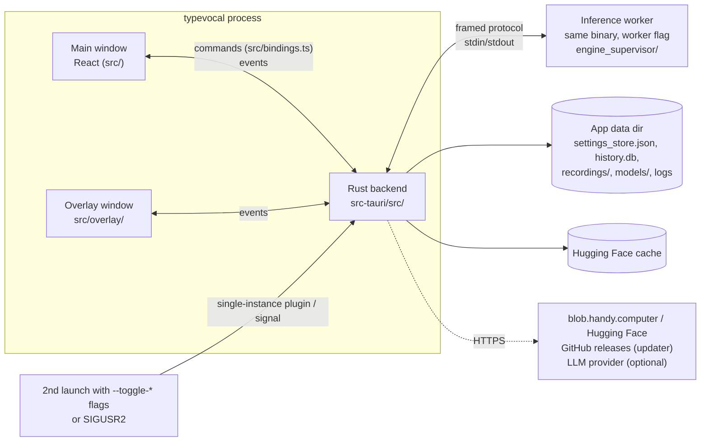
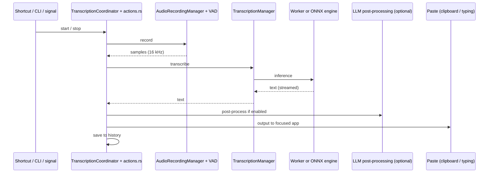

# Architecture

Covers: src/, src-tauri/, index.html, vite.config.ts

TypeVocal is one Tauri 2 desktop process (Rust backend + React webviews) plus a short-lived inference worker process. Everything runs on the user's machine; the network is used only for model downloads, update checks and optional LLM post-processing.

## Components

| Component              | Where                                      | Doc                                              |
| ---------------------- | ------------------------------------------ | ------------------------------------------------ |
| Frontend (main window) | `src/`                                     | [frontend.md](frontend.md)                       |
| Overlay window         | `src/overlay/`, `src-tauri/src/overlay.rs` | [tray and overlay](features/tray-and-overlay.md) |
| Backend                | `src-tauri/src/`                           | [backend.md](backend.md)                         |
| Inference worker       | `src-tauri/src/engine_supervisor/`         | [worker.md](worker.md)                           |

## How the parts talk

- **Frontend → backend:** Tauri commands, called only through the generated `src/bindings.ts` (tauri-specta). Most return `Result<T, string>`.
- **Backend → frontend:** Tauri events. A few are typed in `bindings.ts`; most are raw `listen("name")` with payload types in `src/lib/types/events.ts`.
- **Backend → worker:** `EngineSupervisor` spawns the app binary in worker mode and exchanges framed messages; a worker crash or hang is recovered, with a CPU-only retry. Only transcribe-cpp (whisper-family) inference runs there.
- **Other instances:** `tauri_plugin_single_instance` forwards a second launch's CLI flags to the running app; Unix signals go through `signal_handle.rs`. See [CLI and remote control](features/cli-and-remote-control.md).

## Data

| Store    | Location                                                          | Owner                                                  |
| -------- | ----------------------------------------------------------------- | ------------------------------------------------------ |
| Settings | `settings_store.json` via `tauri-plugin-store`                    | `settings.rs` → [settings](features/settings.md)       |
| History  | `history.db` (SQLite, rusqlite) + `recordings/*.wav`              | `managers/history.rs` → [history](features/history.md) |
| Models   | `models/` in the app data dir, plus the shared Hugging Face cache | `managers/model.rs` → [models](features/models.md)     |
| Logs     | `typevocal.log` in the log dir (`tauri-plugin-log`)               | `lib.rs`                                               |

The app data dir is Tauri's `app_data_dir` for `com.masnunsiam.typevocal`, or a `Data/` folder next to the executable in [portable mode](features/portable-mode.md); always resolve it with `portable::app_data_dir`.

## Main flow: dictation

Details: [recording and transcription](features/recording-and-transcription.md), [paste and text output](features/paste-and-text-output.md), [post-processing](features/post-processing.md).

## Other features

[Onboarding and permissions](features/onboarding-and-permissions.md) · [Updates and release notes](features/updates-and-release-notes.md) · [Tray and overlay](features/tray-and-overlay.md) · [Portable mode](features/portable-mode.md)
