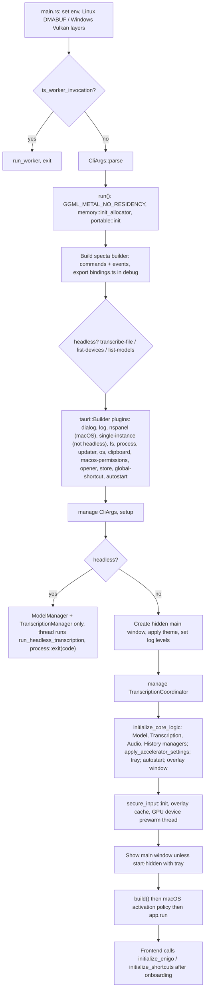

# Backend structure

Covers: src-tauri/src/lib.rs, src-tauri/src/main.rs, src-tauri/src/managers/**, src-tauri/src/commands/**, src-tauri/src/shortcut/**, src-tauri/src/audio_toolkit/**, src-tauri/src/catalog/**, src-tauri/src/paste_tx/**, src-tauri/src/helpers/**, src-tauri/src/\*.rs, src-tauri/build.rs, src-tauri/Cargo.toml, src-tauri/swift/**, src-tauri/capabilities/\*\*, src-tauri/tauri.conf.json

Rust + Tauri 2 crate `typevocal` (lib `typevocal_app_lib`, `src-tauri/Cargo.toml`). Style and binding rules: [guides/backend-conventions.md](guides/backend-conventions.md). Transcription runs in a child process: [worker.md](worker.md).

## Module map

| Path (under `src-tauri/src/`)                                                                 | Role                                                                                                                                                            | Feature doc                                                            |
| --------------------------------------------------------------------------------------------- | --------------------------------------------------------------------------------------------------------------------------------------------------------------- | ---------------------------------------------------------------------- |
| `main.rs`                                                                                     | Platform env tweaks, worker check, `CliArgs::parse`, `run()`                                                                                                    | [cli-and-remote-control](features/cli-and-remote-control.md)           |
| `lib.rs`                                                                                      | Module list, logging, `collect_commands!`/`collect_events!`, plugins, `setup`, `initialize_core_logic`, headless `--transcribe-file` path                       |                                                                        |
| `managers/audio.rs`                                                                           | `AudioRecordingManager`: mic stream, recording state, mute, always-on mode                                                                                      | [recording-and-transcription](features/recording-and-transcription.md) |
| `managers/transcription.rs`                                                                   | `TranscriptionManager`: model load/unload, idle watcher, batch + streaming transcription, ONNX engines in-process, `EngineSupervisor` for the rest              | [recording-and-transcription](features/recording-and-transcription.md) |
| `managers/model.rs`, `model/download.rs`, `model_capabilities.rs`, `gguf_meta.rs`             | `ModelManager`: registry (`ModelInfo`), downloads, disk scan; GGUF header probing                                                                               | [models](features/models.md)                                           |
| `managers/history.rs`                                                                         | `HistoryManager`: SQLite `history.db` + `recordings/` WAVs                                                                                                      | [history](features/history.md)                                         |
| `commands/{audio,history,models,transcription}.rs`, `commands/mod.rs`                         | Thin `#[tauri::command]` handlers; `mod.rs` holds misc commands, `initialize_enigo`, `initialize_shortcuts`, `ShortcutsInitialized`                             |                                                                        |
| `shortcut/mod.rs`, `handler.rs`, `tauri_impl.rs`, `handy_keys.rs`                             | Global shortcut backends, `init_shortcuts`, all `change_*_setting` commands                                                                                     | [settings](features/settings.md)                                       |
| `actions.rs`                                                                                  | `ACTION_MAP`: `transcribe`, `transcribe_with_post_process`, `cancel`, `test` (`ShortcutAction` trait); the recording/paste pipeline entry                       | [recording-and-transcription](features/recording-and-transcription.md) |
| `transcription_coordinator.rs`                                                                | Single-thread state machine serialising key events (debounce, hold/toggle, busy-press queue)                                                                    | [recording-and-transcription](features/recording-and-transcription.md) |
| `settings.rs`                                                                                 | `AppSettings`, `get_settings`/`write_settings`                                                                                                                  | [settings](features/settings.md)                                       |
| `clipboard.rs`, `input.rs`, `paste_tx/`                                                       | Paste via clipboard/keystrokes (enigo, `EnigoState`); receipt-sequenced paste (`macos.rs`, `windows.rs`)                                                        | [paste-and-text-output](features/paste-and-text-output.md)             |
| `llm_client.rs`, `apple_intelligence.rs`                                                      | OpenAI-style HTTP client for post-processing; Apple on-device LLM FFI (macOS aarch64 only)                                                                      | [post-processing](features/post-processing.md)                         |
| `tray.rs`, `tray_i18n.rs`, `overlay.rs`                                                       | Tray icon/menu (desired-state applier), generated tray strings, recording overlay window                                                                        | [tray-and-overlay](features/tray-and-overlay.md)                       |
| `signal_handle.rs`, `cli.rs`                                                                  | SIGUSR2 handler (unix) and `send_transcription_input()`; clap `CliArgs`                                                                                         | [cli-and-remote-control](features/cli-and-remote-control.md)           |
| `portable.rs`                                                                                 | Portable-mode detection; `app_data_dir`, `app_log_dir`, `store_path`                                                                                            | [portable-mode](features/portable-mode.md)                             |
| `secure_input.rs`                                                                             | macOS Secure Event Input monitor and Carbon cancel fallback                                                                                                     | [onboarding-and-permissions](features/onboarding-and-permissions.md)   |
| `audio_toolkit/`                                                                              | No Tauri types: cpal devices/recorder/resampler/visualizer, VAD (`silero`, `earshot`, `smoothed`), `text.rs`, `lang_id.rs`                                      |                                                                        |
| `catalog/`                                                                                    | `catalog.json` embedded bundled model list -> `ModelDescriptor`s                                                                                                | [models](features/models.md)                                           |
| `engine_supervisor/`                                                                          | Worker process supervisor, worker, protocol                                                                                                                     | [worker.md](worker.md)                                                 |
| `utils.rs`                                                                                    | `cancel_current_operation`, `env_flag_enabled`, Wayland/KDE/GNOME detection, Windows-on-ARM emulation check; re-exports `clipboard`, `overlay`, `tray` with `*` |                                                                        |
| `audio_feedback.rs`, `autostart.rs`, `chinese_script.rs`, `memory.rs`, `helpers/clamshell.rs` | Feedback sounds; login item (`SMAppService` on macOS 13+, plugin elsewhere); Simplified/Traditional conversion; glibc malloc tuning; `is_laptop`                |                                                                        |

`audio_toolkit/bin/cli.rs` exists but the `[[bin]]` entry in `Cargo.toml` is commented out.

## Managed state

Registered with `.manage()`; fetch with `app.state::<T>()` / `try_state`.

| State                                 | Registered at                                     | Owns                                                                                             |
| ------------------------------------- | ------------------------------------------------- | ------------------------------------------------------------------------------------------------ |
| `CliArgs`                             | `lib.rs` builder (`.manage(cli_args.clone())`)    | Parsed flags (runtime-only overrides)                                                            |
| `TranscriptionCoordinator`            | `setup`, before `initialize_core_logic`           | mpsc sender to the coordinator thread                                                            |
| `Arc<AudioRecordingManager>`          | `initialize_core_logic`                           | Recorder, `RecordingState`, `MicrophoneMode`; built with `transcription_manager.stream_router()` |
| `Arc<ModelManager>`                   | `initialize_core_logic` (and headless path)       | `models_dir`, `available_models`, per-model `CancellationToken`s                                 |
| `Arc<TranscriptionManager>`           | `initialize_core_logic` (and headless path)       | `EngineSupervisor`, ONNX engine slot, loading flags, `StreamRouter`, idle watcher thread         |
| `Arc<HistoryManager>`                 | `initialize_core_logic`                           | `history.db` path, `recordings/` dir                                                             |
| `tray::TrayState`, the `TrayIcon`     | `initialize_core_logic`                           | Desired tray snapshot, icon handle                                                               |
| `EnigoState`                          | `commands::initialize_enigo` (called by frontend) | Keyboard/mouse simulation                                                                        |
| `ShortcutsInitialized`                | `commands::initialize_shortcuts` (frontend)       | Idempotency marker                                                                               |
| handy-keys state                      | `shortcut/handy_keys.rs` `init_shortcuts`         | Only when that backend is active                                                                 |
| `secure_input::imp::SecureInputState` | `secure_input::init`                              | Secure Input poller state                                                                        |

Managers are constructed in dependency order (model -> transcription -> audio -> history) because later ones take earlier ones.

## Layering

`src/` (React) -> `invoke` (generated `src/bindings.ts`) -> `commands/*` or `shortcut::change_*` -> `State<Arc<XManager>>` and `settings::{get,write}_settings` -> manager -> `audio_toolkit` / `engine_supervisor` / `llm_client`. Backend -> frontend: typed events (`HistoryUpdatePayload`, `StreamTextEvent`, `StreamPhaseEvent`) and untyped `emit` (e.g. `model-state-changed`, `check-for-updates`). Global shortcuts, tray and CLI all converge on `TranscriptionCoordinator` -> `ACTION_MAP`.

Note: setting-change commands live in `shortcut/mod.rs` (not `commands/`), and `commands/mod.rs` has `#[specta::specta]` placed before or after `#[tauri::command]` inconsistently. `lib.rs` also defines `trigger_update_check` and `show_main_window_command` inline.

## Startup sequence

- Enigo and shortcuts are deliberately NOT initialised in `setup`; the frontend triggers them after permissions (avoids early macOS prompts). See [onboarding-and-permissions](features/onboarding-and-permissions.md).
- The main window is created in code (not `tauri.conf.json`, `"windows": []`) so portable mode can set the WebView2 `data_directory`.
- Closing the main window hides it (`CloseRequested` is prevented); quit is via tray `quit` -> `app.exit(0)`.
- No transcription teardown on exit: the worker exits when its stdin closes.
- `signal_handle::setup_signal_handler` is `cfg(unix)`; on Linux SIGUSR1 is intentionally unhandled.

## Build script and features

- `build.rs` (rebrand guard test: `src-tauri/tests/build_rs_rebrand.rs`):
  - macOS aarch64: compiles `swift/apple_intelligence.swift` (or `_stub.swift`) with `swiftc` into `libapple_intelligence.a`, weak-links `FoundationModels`. Stub is used when the SDK lacks the framework, Xcode is CLT-only, or `TYPEVOCAL_FORCE_AI_STUB=1`. Overrides: `SDKROOT`, `SWIFTC`.
  - `generate_tray_translations()`: reads `../src/i18n/locales/*/translation.json` `tray` keys (English defines the schema) and writes `$OUT_DIR/tray_translations.rs` (`TrayStrings`, `TRANSLATIONS`) included by `tray_i18n.rs`.
  - Linux: adds rpath `$ORIGIN/../lib/TypeVocal:$ORIGIN/../lib`.
  - `stage_transcribe_runtime_libs()`: copies transcribe-cpp shared libs/ggml modules (from `DEP_TRANSCRIBE_CPP_RUNTIME_DIR`/`_MODULE_DIR`) into `src-tauri/transcribe-libs/` (no-op for static macOS build). Also `stage_onnxruntime_dll()` (`ORT_PREFER_DYNAMIC_LINK`, `ORT_LIB_LOCATION`) and `stage_vc_runtime_dlls()` (`TYPEVOCAL_VC_REDIST_DIRS`), Windows only.
  - Ends with `tauri_build::build()`.
- Bundling of `transcribe-libs`: `tauri.conf.json` (deb/rpm to `/usr/lib/TypeVocal`, AppImage to `/usr/lib`), `tauri.windows.conf.json` (beside the exe).
- `Cargo.toml` has no `[features]` section. Platform variation is via target tables: `transcribe-cpp` gets `metal` (macOS), `dynamic-backends`+`vulkan` (Linux, Windows x86_64), none/static CPU (Windows aarch64). Other target deps: `tauri-nspanel`, `objc2*` (macOS); `gtk`, `gtk-layer-shell` (Linux); `windows`, `winreg`, `webview2-com` (Windows); `signal-hook` (unix); autostart/global-shortcut/single-instance/updater plugins (non-mobile). `transcribe-rs` is ONNX-only.
- `[patch.crates-io]` pins `tao`/`tao-macros` to a `cjpais/tao` rev. Release profile: LTO, `panic = "unwind"`, strip.

## Swift bridge

`src-tauri/swift/`: `apple_intelligence_bridge.h` (C ABI: `is_apple_intelligence_available`, `process_text_with_system_prompt_apple`, `free_apple_llm_response`), `apple_intelligence.swift` (real, FoundationModels), `apple_intelligence_stub.swift` (same `@_cdecl` symbols, returns unavailable). Rust side: `apple_intelligence.rs` (`extern "C"` + safe wrappers), compiled only under `cfg(all(target_os = "macos", target_arch = "aarch64"))` in `lib.rs`. Exposed to the UI through `commands::check_apple_intelligence_available`.

## Capabilities

- `capabilities/default.json`: windows `main` and `recording_overlay`; core, opener, store, updater, process, dialog, global-shortcut register/unregister, macos-permissions, `fs:read-files`, resource read; `fs:scope` limited to `$APPDATA`.
- `capabilities/desktop.json`: platforms macOS/windows/linux, window `main`: autostart, global-shortcut, updater (duplicate `autostart:default` entries are present).
- `tauri.conf.json`: `csp: null`, asset protocol scope `**`, `macOSPrivateApi: true`. A new plugin command used from a window needs a permission here.
