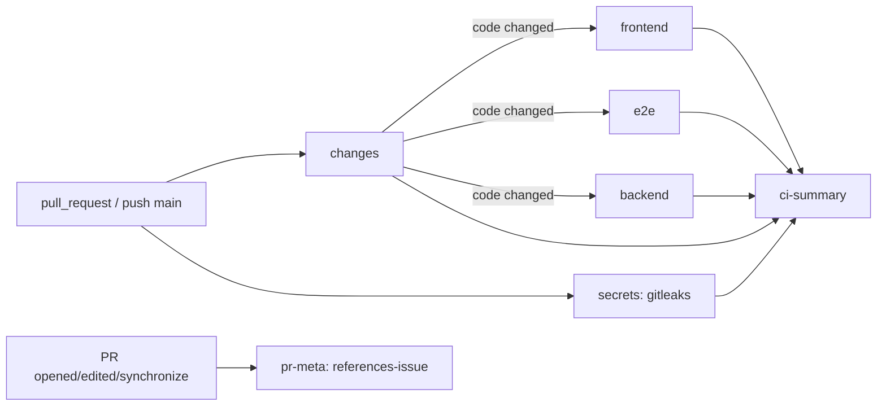

# Development

Covers: Makefile, package.json, .pre-commit-config.yaml, .github/workflows/, scripts/, playwright.config.ts, tests/, tsconfig.json, tsconfig.node.json, eslint.config.js, .prettierrc, .prettierignore, .cargo/config.toml, src-tauri/rustfmt.toml, flake.nix, flake.lock, .nix/, nix/

Setup and first run are in the [README](../README.md#develop); platform packages and build problems in [BUILD.md](../BUILD.md). Coding rules: [frontend](guides/frontend-conventions.md), [backend](guides/backend-conventions.md).

## Make targets

`Makefile` is the entry point; each recipe calls a `package.json` script or cargo.

| Target          | Runs                                                                              |
| --------------- | --------------------------------------------------------------------------------- |
| `make up`       | `bun install --frozen-lockfile`, then `bun run tauri dev` (Vite on :1420 + Rust)  |
| `make down`     | Kills whatever listens on :1420 and any `target/debug/typevocal` process          |
| `make lint`     | `bun run lint`, `bunx tsc --noEmit`, `bun run format:check`, clippy `-D warnings` |
| `make format`   | `bun run format` (Prettier + `cargo fmt`)                                         |
| `make test`     | `test-frontend` + `test-backend`                                                  |
| `test-frontend` | `check:translations`, `check:model-languages`, `scripts/run-unit-tests.sh`        |
| `test-backend`  | `cd src-tauri && cargo test`                                                      |
| `test-e2e`      | Installs Playwright Chromium, `bun run test:playwright`                           |
| `make check`    | `lint` + `test`                                                                   |

## Tests

| Kind               | Where                                                                       | Run                                                                                      |
| ------------------ | --------------------------------------------------------------------------- | ---------------------------------------------------------------------------------------- |
| Bun assert scripts | `**/*.test.ts`, `tests/*.check.ts`                                          | `scripts/run-unit-tests.sh` (every tracked file, stops at first failure) or `bun <file>` |
| Playwright smoke   | `tests/app.spec.ts`; `playwright.config.ts` starts `bunx vite dev` on :1420 | `bun run test:playwright` (frontend only, no Rust backend)                               |
| Rust unit          | `#[cfg(test)]` modules in `src-tauri/src/`                                  | `cd src-tauri && cargo test`                                                             |
| Rust integration   | `src-tauri/tests/`                                                          | same                                                                                     |
| Content checks     | `scripts/check-translations.ts`, `scripts/check-model-language-coverage.ts` | `bun run check:translations`, `bun run check:model-languages`                            |

## Commit and push hooks

`.pre-commit-config.yaml`; install once per clone with `pre-commit install` (installs both stages). Hooks match by path, so a docs-only commit runs only the guards.

| Stage      | Hooks                                                                                                                                                                                                                           |
| ---------- | ------------------------------------------------------------------------------------------------------------------------------------------------------------------------------------------------------------------------------- |
| pre-commit | `no-commit-to-branch` (main), merge markers, gitleaks, CLAUDE.md guards (`scripts/agent/claude-md-guard.sh`), `scripts/agent/no-lint-suppressions.sh`, eslint, `tsc`, Prettier, unit tests, content checks, `cargo fmt --check` |
| pre-push   | `cargo clippy --all-targets -- -D warnings`, `cargo test` (only when `src-tauri/` changed)                                                                                                                                      |

`no-lint-suppressions.sh` fails on added `eslint-disable`, `@ts-ignore`, `@ts-nocheck`, `@ts-expect-error`, `prettier-ignore`, `#[allow(`, `rustfmt::skip` under `src`, `src-tauri`, `scripts`, `tests` (not `scripts/agent/`).

## CI

| Workflow                                                               | Trigger                                                    | What it does                                                                                                                                                                                                        |
| ---------------------------------------------------------------------- | ---------------------------------------------------------- | ------------------------------------------------------------------------------------------------------------------------------------------------------------------------------------------------------------------- |
| `ci.yml`                                                               | PR (opened, synchronize, reopened), push to `main`, manual | `changes` decides code vs doc-only; `frontend` (suppressions, lint, tsc, format, `make test-frontend`), `e2e`, `backend` (Linux deps, clippy, `make test-backend`), `secrets`; `ci-summary` fails if any job failed |
| `pr-meta.yml`                                                          | PR opened, edited, synchronize, reopened                   | Fails when the PR body has no `#<n>` or issue URL                                                                                                                                                                   |
| `nix-check.yml`                                                        | PR touching flake, `.nix/`, `bun.lock`, sources; manual    | Builds the Nix flake package                                                                                                                                                                                        |
| `build.yml`                                                            | Called by other workflows                                  | Per-platform Tauri build and bundles; stages `src-tauri/transcribe-libs/`                                                                                                                                           |
| `build-test.yml`, `main-build.yml`, `pr-test-build.yml`, `release.yml` | Manual (`workflow_dispatch`)                               | Test, main, per-PR and release builds through `build.yml`; see [updates and release](features/updates-and-release-notes.md)                                                                                         |

- Doc-only = `docs/**` and `*.md` outside `src/` (`src/content/release-notes/*.md` ship in the app, so they count as code). Doc-only changes skip `frontend`, `e2e`, `backend`.
- `ci-summary` and `references-issue` are the checks to require on `main`.
- Clippy runs on Linux in CI and reports lints macOS does not (`cfg`-gated code); run it on both when touching platform code.

## Scripts

| Script                                               | Purpose                                                                                        |
| ---------------------------------------------------- | ---------------------------------------------------------------------------------------------- |
| `scripts/run-unit-tests.sh`                          | Runs every bun assert script                                                                   |
| `scripts/check-translations.ts`                      | Every locale has the keys of `src/i18n/locales/en/translation.json`                            |
| `scripts/check-model-language-coverage.ts`           | Model catalog language coverage check                                                          |
| `scripts/check-icons.ts`                             | Icons in `src-tauri/icons` come from the TypeVocal mark                                        |
| `scripts/gen-tray-icons.sh`                          | Regenerates `src-tauri/resources/tray_*.png`                                                   |
| `scripts/gen_catalog.py`, `scripts/mirror_models.py` | Generate the model catalog and mirror model files (`uv run`); see [models](features/models.md) |
| `scripts/check-nix-deps.ts`                          | `postinstall`: keeps `.nix/bun.nix` in sync with `bun.lock`                                    |
| `scripts/ci/stage-transcribe-libs.sh`                | Copies transcribe-cpp dynamic backend libraries next to the binary                             |
| `scripts/agent/*.sh`                                 | CLAUDE.md guards and the suppression check (hooks above)                                       |

## Gotchas

- `src/bindings.ts` is regenerated only by a debug build (`bun run tauri dev`); commit the diff with the Rust command change.
- On a non-APFS drive, macOS `._*` files break eslint and the tauri build, and git does not keep the executable bit (`core.fileMode=false`), so mark new scripts with `git update-index --chmod=+x <file>`. Workaround for the build in [BUILD.md](../BUILD.md#macos).
- A custom `CARGO_TARGET_DIR` must end in a folder named `target`, or the dev app cannot resolve its resources and panics at startup.
- The first `cargo` build compiles ~820 crates including transcribe.cpp (CMake); expect several minutes.
