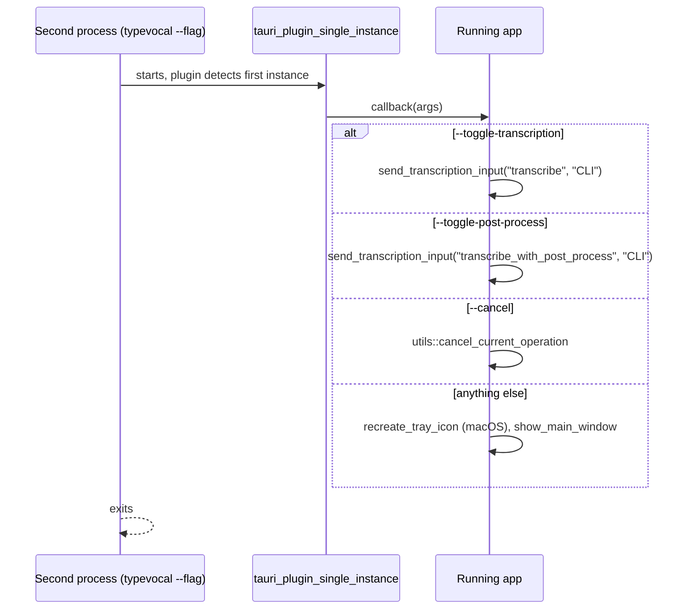

# CLI and Remote Control

Covers: src-tauri/src/cli.rs, src-tauri/src/main.rs, src-tauri/src/signal_handle.rs, src-tauri/src/lib.rs, src-tauri/src/transcription_coordinator.rs

User-facing usage and examples: [CLI runbook](../runbooks/cli.md). Conventions: [backend](../guides/backend-conventions.md). Window and tray side effects: [tray-and-overlay.md](tray-and-overlay.md).

## Flags (`cli.rs`, clap derive `CliArgs`)

| Flag                                                                                                         | Kind                  | Handled in                                                                                              |
| ------------------------------------------------------------------------------------------------------------ | --------------------- | ------------------------------------------------------------------------------------------------------- |
| `--start-hidden`, `--no-tray`                                                                                | startup, runtime-only | `lib.rs` setup and `apply_startup_activation_policy` (macOS)                                            |
| `--debug`                                                                                                    | startup               | `lib.rs` setup: forces `debug_mode` and `LogLevel::Trace` on the in-memory settings only, not persisted |
| `--toggle-transcription`, `--toggle-post-process`, `--cancel`                                                | remote control        | single-instance callback in `lib.rs`                                                                    |
| `-f/--transcribe-file`, `--model`, `--device-index`, `--repeat`, `--json`, `--list-models`, `--list-devices` | headless              | `run_headless_transcription` in `lib.rs`                                                                |

Flags never modify persisted settings. Adding a flag: add the field to `CliArgs`, then handle it in `lib.rs`; `CliArgs` is `pub use`d from `lib.rs` and stored with `.manage(cli_args.clone())`, so any code can read `app.state::<CliArgs>()`.

## Startup path (`main.rs`)

1. Linux: sets `WEBKIT_DISABLE_DMABUF_RENDERER=1`. Windows: sets `VK_LOADER_LAYERS_DISABLE=~implicit~` unless already set or `TYPEVOCAL_KEEP_VULKAN_IMPLICIT_LAYERS` is truthy.
2. If `argv[1] == --transcribe-worker` (`engine_supervisor::is_worker_invocation`), run the inference worker and exit. The worker never parses `CliArgs` or touches Tauri.
3. `CliArgs::parse()` (clap exits itself on bad args or `--help`), then `typevocal_app_lib::run(cli_args)`.

Release Windows builds use `windows_subsystem = "windows"` (no console), so stdout from `--help` or the headless path is not expected to show in a terminal there.

## Remote control via single instance

- The callback is an if/else-if chain over raw `args`: only the first match runs, in the order above.
- Gotcha: `--start-hidden`, `--debug` or `--no-tray` sent to an already-running instance fall into the last branch and raise its window; they do not change the running app.
- The plugin is registered only when `headless_mode` is false (`transcribe_file`, `list_devices` or `list_models` set), so headless runs are standalone instances even if the app is open.

## `signal_handle.rs`

- `send_transcription_input(app, binding_id, source)`: gets the managed `TranscriptionCoordinator` and calls `send_external_input`, which behaves as a toggle press exempt from debounce. Logs a warning if the coordinator is not initialized. Shared by CLI and signals; binding ids are `transcribe` and `transcribe_with_post_process`.
- `setup_signal_handler` (`#[cfg(unix)]`, called from `initialize_core_logic`, spawns a thread over `signal_hook`): SIGUSR2 toggles `transcribe` on all Unix. SIGUSR1 (`transcribe_with_post_process`) is registered only on macOS; on Linux WebKitGTK uses SIGUSR1 internally and handling it caused phantom recordings (#1660). Windows has no signal path; use the CLI flags.
- Unlike `--toggle-*`, signals work only if the process is already running, and require `initialize_core_logic` to have run (not in headless mode).

## Headless path (`lib.rs`)

`headless_mode = transcribe_file.is_some() || list_devices || list_models`. In `setup`, when true:

- Initializes only `ModelManager` and `TranscriptionManager`, reports compute devices, applies accelerator settings. No main window, tray, overlay, audio recorder (mic never opens), signal handlers, or autostart. macOS activation policy is left alone.
- Runs `run_headless_guarded(run_headless_transcription)` on a worker thread, then `process::exit(code)` after flushing stdout/stderr (so the code reaches the shell; `app.exit` would always be 0).
- Exit codes: 0 ok, 1 runtime failure (including a caught panic), 2 bad input.
- Order inside `run_headless_transcription`: `--list-devices` (prints, returns 0 unless a file is also given), `--list-models` (`--json` prints the `ModelInfo` array), then the file transcription.
- File must be 16 kHz mono 16-bit integer PCM WAV, else exit 2. Model defaults to the selected one in settings; it must already be installed (no download). `--device-index` is not persisted; `--repeat` reports `best_ms` and `rtf`. `--json` output keys: `model`, `requested_device`, `bound_backend`, `audio_secs`, `load_ms`, `transcribe_ms`, `best_ms`, `rtf`, `text`.
- Headless console logs go to stderr (not stdout) so stdout carries only the result; file logs still use the normal (or portable) log dir.
