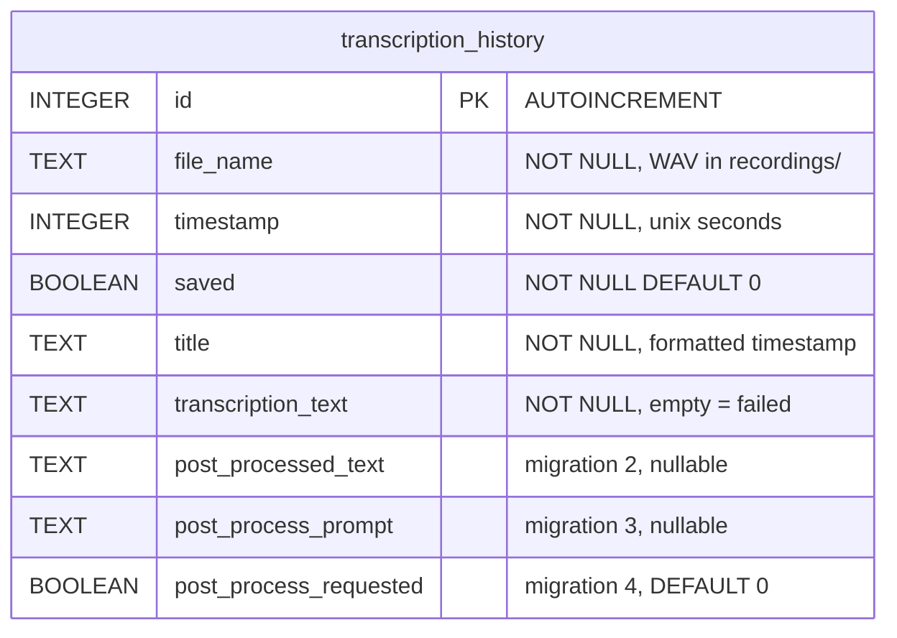
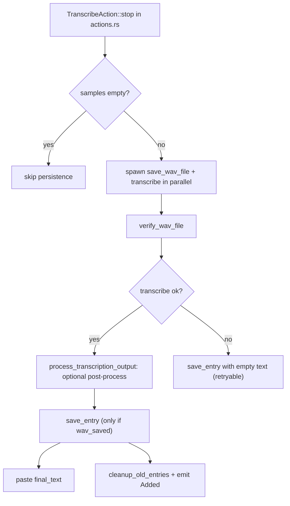

# Transcription History

Covers: src-tauri/src/managers/history.rs, src-tauri/src/commands/history.rs, src-tauri/src/actions.rs, src/components/settings/history/\*\*, src/components/settings/HistoryLimit.tsx, src/components/settings/RecordingRetentionPeriod.tsx

Every completed recording is saved as a WAV plus a row in SQLite. The settings page lists, copies, stars, deletes and re-transcribes entries. Recording/transcription itself: [recording-and-transcription.md](recording-and-transcription.md). Conventions: [backend](../guides/backend-conventions.md), [frontend](../guides/frontend-conventions.md).

## Storage

- DB: `<app_data_dir>/history.db` (rusqlite, a new `Connection` per call via `get_connection`, no pool). WAVs: `<app_data_dir>/recordings/typevocal-<unix_ts>.wav` (`HistoryManager::recording_file_name`). `app_data_dir` comes from `crate::portable::app_data_dir` (portable-aware).
- `HistoryManager` is built in `lib.rs` at startup (panics via `expect` if init fails) and managed as `Arc<HistoryManager>`.
- Migrations: `static MIGRATIONS` (rusqlite_migration, tracked by `PRAGMA user_version`). Append only; debug builds run `migrations.validate()`.

| #   | Migration                                                                     |
| --- | ----------------------------------------------------------------------------- |
| 1   | `CREATE TABLE IF NOT EXISTS transcription_history` (6 base columns)           |
| 2-4 | `ADD COLUMN` post_processed_text, post_process_prompt, post_process_requested |

- Legacy: `migrate_from_tauri_plugin_sql` runs first. If `_sqlx_migrations` exists and `user_version == 0`, it copies `MAX(version)` (success=1) into `user_version` so migrations 1-4 do not re-run. The old table is left in place.
- Rust type `HistoryEntry` mirrors the row; `bindings.ts` is generated (never hand-edit).

## Save flow

- `save_entry` inserts with `saved=false`, `title` from the timestamp, then calls `cleanup_old_entries()`, then emits `HistoryUpdatePayload::Added`.
- Entry is saved before paste. Cancelled operations return earlier and save nothing.
- Failed transcription: row saved with `transcription_text = ''`; UI shows "transcription failed" and offers re-transcribe. `get_latest_completed_entry` (tray "copy last transcript", `tray.rs`) filters `transcription_text != ''`.
- Post-process fields only record what was applied; see [post-processing.md](post-processing.md).

## Retention

`cleanup_old_entries` reads `recording_retention_period` (`RecordingRetentionPeriod` in `settings.rs`):

| Value (snake_case)           | Behavior                                             |
| ---------------------------- | ---------------------------------------------------- |
| `never`                      | delete nothing                                       |
| `preserve_limit` (default)   | keep newest `history_limit` unsaved rows (default 5) |
| `days3`, `weeks2`, `months3` | delete unsaved rows older than 3d / 14d / 90d        |

- Rows with `saved = 1` (star) are never auto-deleted. Deleting removes row and WAV (`delete_entries_and_files`); a failed file delete is logged only.
- Cleanup runs on every `save_entry` and when either setting changes.
- Gotcha: `history_limit` is only used under `preserve_limit`. The UI input (`HistoryLimit.tsx`, min 0) lives in Advanced settings next to `RecordingRetentionPeriod.tsx`.

## Commands (`commands/history.rs`, registered in `lib.rs`)

`get_history_entries(cursor, limit)` (keyset on `id DESC`, limit capped at 100, `has_more` via limit+1 fetch), `toggle_history_entry_saved`, `get_audio_file_path`, `delete_history_entry`, `retry_history_entry_transcription`, `update_history_limit`, `update_recording_retention_period`. Also `open_recordings_folder` in `commands/mod.rs`.

- The two `update_*` commands are wired in `settingsStore.ts` `settingUpdaters`; they write settings directly and trigger cleanup (see [settings.md](settings.md)). `update_recording_retention_period` takes a string and rejects unknown values.
- Retry: loads the WAV (`read_wav_samples`), `initiate_model_load`, `transcribe` in `spawn_blocking`, errors on empty audio or empty text, re-runs `process_transcription_output` using the row's `post_process_requested`, then `update_transcription` (emits `Updated`). It does not paste.

## Events and frontend

- `HistoryUpdatePayload` (tagged by `action`): `added`, `updated`, `deleted`, `toggled`. Frontend: `events.historyUpdatePayload`.
- `HistorySettings.tsx`: loads pages of `PAGE_SIZE = 30` with an IntersectionObserver sentinel. Handles only `added` (prepend) and `updated` (replace) from events; `deleted`/`toggled` are applied optimistically in the component, so the event is ignored to avoid double-mutation.
- Per-entry actions: copy (`clipboard.ts` `copyToClipboard`, tested in `clipboard.test.ts`), star/unstar, delete, re-transcribe, audio playback via `getAudioFilePath`, "open folder".
- Strings: `settings.history.*` in `src/i18n/locales/en/translation.json` (limit input uses `settings.debug.historyLimit.*`).
