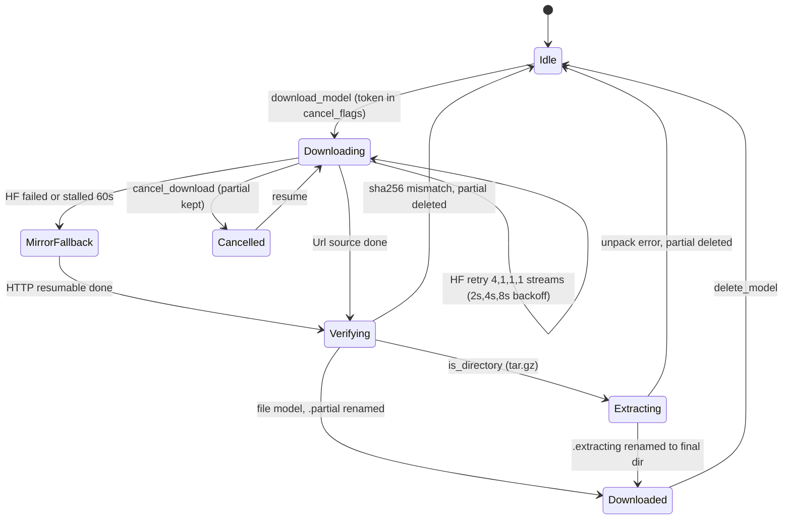
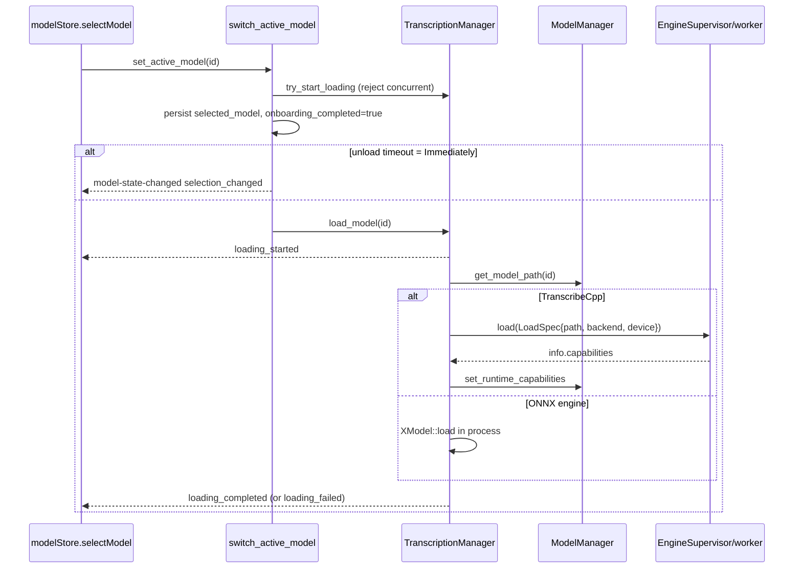

# Models: catalog, download and loading

Covers: src-tauri/src/catalog/**, src-tauri/src/managers/model.rs, src-tauri/src/managers/model/**, src-tauri/src/managers/model_capabilities.rs, src-tauri/src/managers/gguf_meta.rs, src-tauri/src/commands/models.rs, src-tauri/src/managers/transcription.rs (load path), scripts/gen_catalog.py, scripts/mirror_models.py, scripts/check-model-language-coverage.ts, src/stores/modelStore.ts, src/components/model-selector/**, src/components/settings/models/**, src/components/onboarding/\*\*

## Engines and families

`EngineType` (`managers/model.rs`) decides which runtime loads a model. Worker process internals: [../worker.md](../worker.md).

| Engine                                                                                    | Families                                                                                                                                                                                                                                                   | Format                      | Where it runs                                 | Source                                                 |
| ----------------------------------------------------------------------------------------- | ---------------------------------------------------------------------------------------------------------------------------------------------------------------------------------------------------------------------------------------------------------- | --------------------------- | --------------------------------------------- | ------------------------------------------------------ |
| `TranscribeCpp`                                                                           | every `catalog.json` entry (whisper, parakeet, nemotron, canary, cohere, qwen3_asr, voxtral, moonshine, gigaam, granite, funasr, sensevoice, medasr, moss) plus legacy `small`, `medium`, `turbo`, `large`, `breeze-asr`; arch auto-detected from the file | `.gguf`, legacy GGML `.bin` | worker process via `EngineSupervisor`         | catalog (HF), legacy (Url), custom/HF-cache (Local/HF) |
| `Parakeet`, `Moonshine`, `MoonshineStreaming`, `SenseVoice`, `GigaAM`, `Canary`, `Cohere` | legacy hard-coded ONNX entries (e.g. `parakeet-tdt-0.6b-v3`, `canary-180m-flash`, `cohere-int8`)                                                                                                                                                           | directory from a `.tar.gz`  | in-process via `transcribe-rs` (`OnnxEngine`) | `ModelSource::Url`                                     |

- Catalog is 69 models at this commit, all mapped to `EngineType::TranscribeCpp` in `catalog/mod.rs`.
- Legacy ONNX/`.bin` entries are built inline in `ModelManager::new` and have ids like `parakeet-tdt-0.6b-v2`. Catalog ids are `{repo_id}/{filename}`, so the two never merge.
- Legacy `Url` entries are hidden in the UI unless already downloaded (`isLegacyModel` in `ModelsSettings.tsx`, `isLegacySource` in onboarding).
- `ModelSource`: `Url{url,sha256}`, `HuggingFace{repo_id,revision}`, `Local`.
- `ModelInfo` (specta type, mirrored in `src/bindings.ts`) is the frontend shape. `ModelDescriptor` is the catalog-side spec; `to_model_info(&DiskStatus)` renders it. Scores are 0-100 in JSON, 0.0-1.0 in `ModelInfo`. Both 0.0 means "custom, hide score bars".

## Catalog generation

- `src-tauri/src/catalog/catalog.json` is committed and `include_str!`'d into the binary (`ROOT`, `CATALOG` lazies). The `mod.rs` header says "generated at build time", but it is a manual script run whose output is committed.
- `scripts/gen_catalog.py` (uv, needs `HF_TOKEN`): lists the `handy-computer` HF org, reads each card's `transcribe_cpp` block (capabilities, benchmarks), range-reads a GGUF header, then applies the in-file `CURATION` dict (rank, `rec`, description, default quant, `hidden`). Scores: speed from rtf, accuracy from WER. Output path defaults to `scripts/catalog.json`, not the Rust path: pass `src-tauri/src/catalog/catalog.json` explicitly. Any repo failure aborts with exit 1.
- Each entry: `id`, pinned `revision` sha, `architecture`, `languages`, `capabilities{streaming,translate,lang_detect,timestamps}`, `files[]{filename,quant,size_bytes,sha256}`, `default_quant`, `recommended`, `recommended_rank`. `timestamps` is parsed-but-unused (no `CapabilityProbe` field).
- `recommended` (onboarding set and badge) is independent of `recommended_rank` (list order).
- `scripts/mirror_models.py` (boto3, R2 env vars): uploads each model's default quant to `{mirror}/{repo_id}/{revision}/{filename}`. Dry run by default; `--execute`, `--verify`, `--only`, `--all-quants`. Run it after regenerating the catalog so the mirror has the new revisions.
- Mirror list is `mirrors` in `catalog.json` (`https://blob.handy.computer`).
- `scripts/check-model-language-coverage.ts` (`bun run check:model-languages`): every catalog language code must match exactly one `MODEL_CAPABILITY_LANGUAGES` intent in `src/lib/constants/languages.ts`. CI runs it through `make test-frontend` (`ci.yml`), as does the pre-commit `content-checks` hook on catalog changes.
- Rust tests in `catalog/mod.rs`: unique ids, scores in range, every model has mirror fallbacks with 64-char sha256, every architecture is in `KNOWN_ARCHES`, no `sortformer` (diarization only).

## Registry (`ModelManager`)

`ModelManager::new` order: legacy entries -> `seed_catalog_models` (additive) -> `discover_custom_transcribe_models` -> `discover_hf_cache_models` -> `migrate_bundled_models` -> `migrate_gigaam_to_directory` -> `update_download_status` -> `auto_select_model_if_needed`.

- State: `available_models: Mutex<HashMap<id, ModelInfo>>`, `cancel_flags` (token per in-flight download), `extracting_models`, `is_rescanning` (single-flight).
- Models dir: `portable::app_data_dir()/models`.
- **Custom models**: any `.bin`/`.gguf` in the models dir that is not a predefined filename. A file matching a catalog quant surfaces as that catalog model (non-default quants get a `(Q4_K_M)` suffix and no Recommended badge). Otherwise `source: Local`, `is_custom: true`, `description: "Not officially supported"`, caps from `GgufHeaderProber` (`.bin` gets none until load).
- **Shared HF cache**: `hf_caches()` (hf-hub `Cache::from_env()`, plus the pre-0.9.6 cache when portable). Scans `models--*` for `.gguf`; keeps only `Compatibility::Compatible` archs. Revision from `refs/` (prefers `main`). Lookup `hf_cached_path` falls back to `refs/main` for pre-pinning caches.
- Entries that exist only because of disk discovery (custom, alternate quants) are removed when the file vanishes (`disappears_when_missing`). Catalog defaults and legacy entries stay so they can be re-downloaded.
- `rescan_local_models` re-runs discovery off-lock, merges new ids only, emits `models-updated`. Triggered from the Models settings page (`rescanLocalModels`).
- `get_available_models` sort: `catalog::rank_of` (unranked = `u32::MAX`), recommended, accuracy, speed, name.
- Auto-select: clears `selected_model` if its file is gone; skipped until `onboarding_completed`; then picks the first downloaded model in list order.
- `get_model_path` returns the HF cache path or the models-dir copy; on a missing path calls `mark_model_unavailable`. Directory models with a `.partial` next to them are "incomplete".

## Download and delete

Entry: `commands::models::download_model` -> `ModelManager::download_model`. On error the command logs and emits `model-download-failed {model_id, error}`.

- **HF path** (`download_hf_model`): skips if already in HF cache or models dir. hf-hub with `with_token(None)` (public repos, ignores stored tokens), pinned revision, resumes via `.sync.part`. A watchdog cancels the attempt after `DOWNLOAD_STALL_TIMEOUT` (60 s); user cancel returns `Ok` and leaves the partial. After the retries, tries each `catalog::mirror_fallbacks(id)` entry. No explicit sha256 check on the hf-hub path; the pin is the integrity guarantee.
- **Mirror and Url path**: `download_http_resumable` in `managers/model/download.rs`. Appends to `<file>.partial` with `Range`; handles 200-to-Range (restart), 206 offset mismatch, 416, oversize body (cut off and deleted), size and sha256 check via `verify_sha256` (mismatch deletes the partial). Mirror files land in the models dir (HF resolution accepts that); a mirror without catalog sha256 is never offered. Tests: `download/tests.rs`.
- **tar.gz** (`is_directory`, Url only): unpack into `<name>.extracting`, move the single top-level dir (or the temp dir) to `<name>`, delete the archive. Failure deletes the archive so retry starts clean. Leftover `.extracting` dirs are cleaned in `update_download_status`.
- **Delete** (`delete_model`): for the active model the command first unloads it and clears `selected_model`. HF default quant removes the whole `models--org--name` repo dir; a catalog alternate quant removes only its pointer and blob; models-dir copy and `.partial` are always removed. Idempotent. Custom and alternate-quant entries are dropped from the registry.
- `cancel_download` triggers the token, resets `is_downloading`, emits `model-download-cancelled`.

### Events

| Event                                       | Payload                                                                                                                                                      | Emitted by                                |
| ------------------------------------------- | ------------------------------------------------------------------------------------------------------------------------------------------------------------ | ----------------------------------------- |
| `model-download-progress`                   | `DownloadProgress {model_id, downloaded, total, percentage}`, throttled to 100 ms                                                                            | HF progress and HTTP downloader           |
| `model-verification-started` / `-completed` | model id                                                                                                                                                     | `download.rs`                             |
| `model-extraction-started` / `-completed`   | model id                                                                                                                                                     | `download_model`                          |
| `model-extraction-failed`                   | `{model_id, error}`                                                                                                                                          | `download_model`                          |
| `model-download-complete`                   | model id                                                                                                                                                     | all download paths                        |
| `model-download-failed`                     | `{model_id, error}`                                                                                                                                          | `commands/models.rs`                      |
| `model-download-cancelled`, `model-deleted` | model id                                                                                                                                                     | `cancel_download`, `delete_model`         |
| `models-updated`                            | none                                                                                                                                                         | rescan, `mark_model_unavailable`          |
| `model-state-changed`                       | `ModelStateEvent {event_type, model_id, model_name, error}`; types `loading_started`, `loading_completed`, `loading_failed`, `unloaded`, `selection_changed` | `transcription.rs`, `switch_active_model` |

## Capabilities and languages

- `model_capabilities.rs`: `CapabilityProber` trait, one impl `GgufHeaderProber`. Reads `general.architecture`, `general.name`, `stt.variant`, `general.languages`, `stt.capability.{streaming,translate,lang_detect}`. `Compatibility`: `Compatible` (arch in `KNOWN_ARCHES`), `MaybeIncompatible`, `Unsupported`, `Unknown`. Add new archs to `KNOWN_ARCHES` or the catalog test fails.
- `gguf_meta.rs`: dependency-free GGUF v2+/v3 header-only parser; short buffers give `GgufError::Truncated`.
- Every probe field is `Option`: `None` = unknown (parakeet streaming is inferred at load, not in the header).
- After a transcribe-cpp load, `set_runtime_capabilities` overwrites streaming, translate, lang-detect and languages with the loaded model's values. An empty language list keeps the probed one.
- `effective_language(intent, supported, detect)` is applied at point of use and never written back to settings. It matches by base code, and `nb` maps to `no`, `fil` to `tl`, `zh-Hans`/`zh-Hant` to `zh`. If neither the intent nor auto detection works, it falls back to `en`, else the first language.
- `supports_language_selection` = more than one supported language.

## Loading, unloading, devices

- On `load_model` failure `switch_active_model` reverts `selected_model` and `onboarding_completed`.
- The previous model is dropped before the new one loads (peak memory). Idle unloading is driven by `model_unload_timeout`; `Immediately` unloads after each transcription and loads on demand.
- Device choice (transcribe-cpp only), in `managers/transcription.rs`: `resolve_gpu_device` (only when the setting is `Gpu` with a stored `transcribe_gpu_device` key) else `select_transcribe_backend` (`Cpu` -> `Backend::Cpu`, `Auto`/`Gpu` -> `Backend::Auto`). `load_model_with_device(id, Some(index))` hard-selects a registry index (CLI `--device-index`) and is not persisted. The bound backend can differ from the request (CPU fallback).
- `transcribe_gpu_disabled_for_host` (Windows x64 emulated on ARM64) forces CPU.
- ONNX engines use `OrtAcceleratorSetting` (`Auto`, `Cpu`, `Cuda`, `DirectMl`, `Rocm`) via `apply_accelerator_settings`, called at every load.
- The settings handlers in `shortcut/mod.rs` call `reload_model_on_next_use` and `retry_transcribe_gpu` rather than reloading mid-transcription.

## Frontend

| Piece                                                         | Role                                                                                                                                                                                                                                                                                                                     |
| ------------------------------------------------------------- | ------------------------------------------------------------------------------------------------------------------------------------------------------------------------------------------------------------------------------------------------------------------------------------------------------------------------ |
| `src/stores/modelStore.ts` (`useModelStore`)                  | Zustand+Immer: `models`, `currentModel`, `downloadingModels`, `verifyingModels`, `extractingModels`, `downloadProgress`, `downloadStats` (EMA speed). `initialize()` loads models and registers all `listen` handlers for the events above; `models-updated`, `model-deleted` and `model-state-changed` reload the list. |
| `components/settings/models/ModelsSettings.tsx`               | Full list: search, language filter, streaming/translation filters, downloaded section (custom last) vs available, rescan button. Hides undownloaded legacy `Url` models.                                                                                                                                                 |
| `components/model-selector/`                                  | Footer picker (`ModelSelector`, `ModelDropdown`, `ModelStatusButton`, `DownloadProgressDisplay`). Derives status from `model-state-changed` plus store maps.                                                                                                                                                             |
| `components/onboarding/Onboarding.tsx`, `ModelCard.tsx`       | Models not downloaded and not legacy; first two `is_recommended` are top picks, the rest sits behind "Show all". Picking calls `downloadModel`; when downloaded, not verifying and not extracting, it calls `selectModel` then `onModelSelected`.                                                                        |
| `lib/utils/modelTranslation.ts`, `lib/constants/languages.ts` | Model name/description i18n and `supportsLanguageCode` matching.                                                                                                                                                                                                                                                         |

- All strings go through i18next; see [../guides/frontend-conventions.md](../guides/frontend-conventions.md) and [../guides/backend-conventions.md](../guides/backend-conventions.md).
- Manual install or download problems: [../runbooks/troubleshooting.md](../runbooks/troubleshooting.md).

## Gotchas

- Changing catalog ids or default quant changes the registry id (`{repo}/{default_filename}`) and orphans `selected_model` for users who had it.
- Catalog edits need `catalog.json` regenerated, mirror uploaded and the language check run; the unit tests need a sha256 and mirror for every entry.
- Downloads use `ApiBuilder::from_env()`, so `HF_ENDPOINT` and `HF_HOME` apply; tokens are ignored on purpose.
