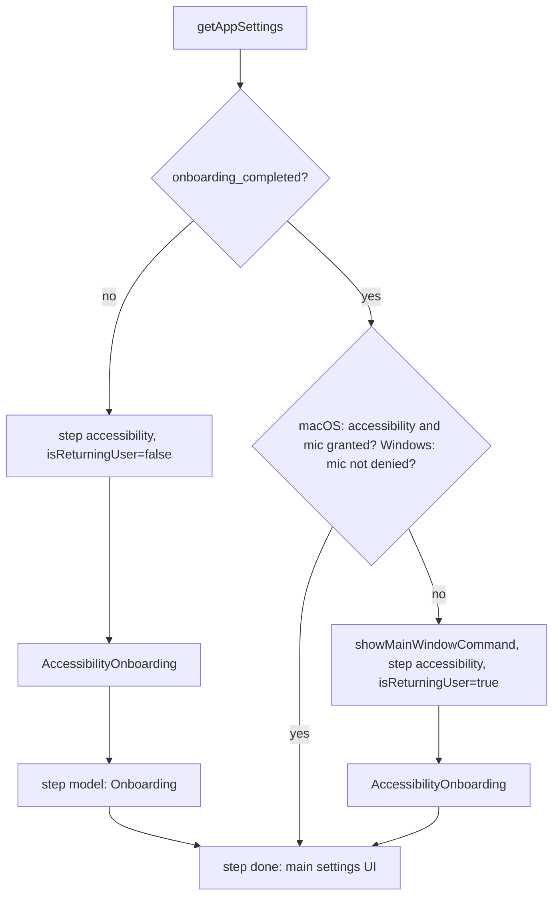

# Onboarding and Permissions

Covers: src/App.tsx, src/components/onboarding/, src/components/AccessibilityPermissions.tsx, src-tauri/Info.plist, src-tauri/Entitlements.plist, src-tauri/gen/apple/PrivacyInfo.xcprivacy, src-tauri/src/commands/audio.rs, src-tauri/src/commands/models.rs

Conventions: [frontend](../guides/frontend-conventions.md), [backend](../guides/backend-conventions.md). Secure Input (shortcuts blocked on macOS) is covered in [recording-and-transcription.md](recording-and-transcription.md). Settings mechanics: [settings.md](settings.md). macOS build details: [BUILD.md](../../BUILD.md).

## Gate in `App.tsx`

`checkOnboardingStatus` runs once on mount and sets `onboardingStep`: `null` (renders nothing), `"accessibility"`, `"model"` or `"done"`. Backing field: `settings.onboarding_completed`.

- Returning users who lost a permission skip the model step. If a permission check throws, the app proceeds to `done` (they fix it in settings); a failure reading settings falls back to `accessibility`.
- Only on `done` does the app call `commands.initializeEnigo()` and `commands.initializeShortcuts()` (once, `hasCompletedPostOnboardingInit`) and refresh audio devices. The backend deliberately does not initialize them at startup so macOS permission prompts appear only after the user is ready (`lib.rs::initialize_core_logic`).
- `Toaster` is rendered once around every step so errors during onboarding surface; recording, paste, transcription and model-load errors are toasts wired in `App.tsx`.
- Debug panel can preview either step (`onboardingPreview`, `preview` prop makes components inert).

## Steps

| Component                                     | Purpose                                                          |
| --------------------------------------------- | ---------------------------------------------------------------- |
| `onboarding/AccessibilityOnboarding.tsx`      | Permission cards per platform, polling after the user acts       |
| `onboarding/Onboarding.tsx` + `ModelCard.tsx` | Pick and download a model; on completion calls `onModelSelected` |

### Permission step by platform

| Platform      | Cards                     | Mechanism                                                                                                                                                                                          |
| ------------- | ------------------------- | -------------------------------------------------------------------------------------------------------------------------------------------------------------------------------------------------- |
| macOS         | Microphone, Accessibility | `tauri-plugin-macos-permissions-api` (`check*/request*Permission`); plugin registered in `lib.rs`, capability `macos-permissions:default`                                                          |
| Windows       | Microphone only           | `commands.getWindowsMicrophonePermissionStatus()` (registry-based, `commands/audio.rs`, `overall_access` of `allowed`/`denied`/`unknown`); button calls `commands.openMicrophonePrivacySettings()` |
| Linux / other | none                      | `onComplete()` immediately                                                                                                                                                                         |

After a request, status goes `waiting` and a `setInterval` poll re-checks until granted, then `initializeEnigo` and `initializeShortcuts` run (macOS), devices are refreshed and `onComplete` fires after 300 ms. Windows treats an unsupported status as granted.

### Model step and completion flag

`onboarding_completed` is set to `true` backend-side by `commands/models.rs::switch_active_model` when the first model is selected (and reverted if loading fails). Legacy stores without the field get it derived from `selected_model` being non-empty (`settings.rs`). Until it is true, `ModelManager` skips auto-selecting a model found on disk, so onboarding always shows the choice.

## After onboarding: `AccessibilityPermissions.tsx`

Rendered at the top of the settings page. macOS only; renders nothing when accessibility is granted. Checks on boot, button first requests, then re-checks (`request` then `verify` states).

## macOS bundle files (`src-tauri/`)

| File                              | Content                                                                         | Wired by                                                                                                                                                       |
| --------------------------------- | ------------------------------------------------------------------------------- | -------------------------------------------------------------------------------------------------------------------------------------------------------------- |
| `Info.plist`                      | `NSMicrophoneUsageDescription` only (English, not localized)                    | Tauri merges `Info.plist` beside `tauri.conf.json` into the bundle (not referenced explicitly in config)                                                       |
| `Entitlements.plist`              | `com.apple.security.device.microphone`, `com.apple.security.device.audio-input` | `bundle.macOS.entitlements` in `tauri.conf.json`, with `hardenedRuntime: true`, `minimumSystemVersion` 10.15, `signingIdentity` `-` (overridden in CI signing) |
| `gen/apple/PrivacyInfo.xcprivacy` | Privacy manifest: required-reason API `FileTimestamp` with reason `C617.1`      | Checked in under `gen/apple`; not referenced from `tauri.conf.json`                                                                                            |

Gotchas:

- There is no Accessibility or Input Monitoring usage string or entitlement; accessibility trust is granted by the user in System Settings and checked at runtime.
- Adding a new TCC-protected capability (camera, screen capture, etc.) needs both a usage string in `Info.plist` and, under hardened runtime, an entitlement.
