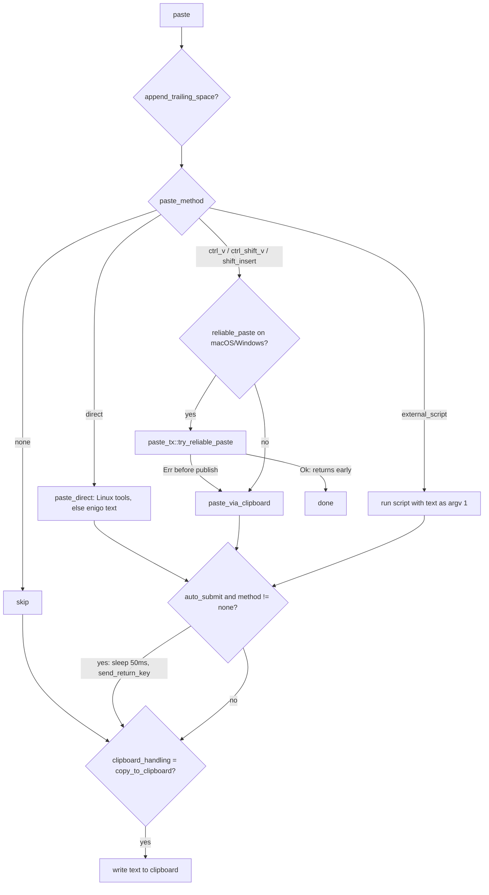

# Paste and Text Output

Covers: src-tauri/src/clipboard.rs, src-tauri/src/input.rs, src-tauri/src/paste_tx/\*\*, src/components/settings/PasteMethod.tsx, src/components/settings/TypingTool.tsx, src/components/settings/ClipboardHandling.tsx, src/components/settings/AutoSubmit.tsx, src/components/settings/AppendTrailingSpace.tsx, src/components/settings/debug/PasteDelay.tsx, src/components/settings/debug/ReliablePaste.tsx

How final text reaches the focused app. Upstream: [recording-and-transcription.md](recording-and-transcription.md) (calls `utils::paste` on the main thread; `utils` re-exports `clipboard::*`) and [post-processing.md](post-processing.md). Conventions: [backend](../guides/backend-conventions.md), [frontend](../guides/frontend-conventions.md).

## Flow

`clipboard::paste(text, app)` reads settings and branches on `paste_method`:

## Methods by OS

| `PasteMethod`     | UI label               | macOS                                                                          | Windows       | Linux         |
| ----------------- | ---------------------- | ------------------------------------------------------------------------------ | ------------- | ------------- |
| `ctrl_v`          | Clipboard (Cmd/Ctrl+V) | yes (default)                                                                  | yes (default) | yes           |
| `direct`          | Direct typing          | hidden/disabled (kept visible if already saved); backend still types via enigo | yes           | yes (default) |
| `ctrl_shift_v`    | Clipboard Ctrl+Shift+V | no                                                                             | yes           | yes           |
| `shift_insert`    | Clipboard Shift+Insert | no                                                                             | yes           | yes           |
| `external_script` | External script        | no                                                                             | no            | yes           |
| `none`            | Do nothing             | yes                                                                            | yes           | yes           |

- Defaults: `PasteMethod::default()` in `settings.rs` (Direct on Linux, CtrlV elsewhere). Visibility rules live only in the frontend (`PasteMethod.tsx` via `useOsType`); the backend does not reject a method for the wrong OS.
- `external_script`: `paste_via_external_script` runs `external_script_path` with the text as the only argument, stdio null, error on non-zero exit. Errors if the path is empty. Path input appears under the dropdown.

## Clipboard paste (`paste_via_clipboard`)

1. Save clipboard: text if non-empty, otherwise try an image (so screenshots survive).
2. Write transcript (`write_text_to_clipboard`: uses `wl-copy` on Wayland when present, else the clipboard plugin).
3. Sleep `paste_delay_ms` (default 60), send chord, sleep `paste_delay_after_ms` (default 60).
4. Restore: text, else image, else `clipboard.clear()`. Restore runs even if the chord failed (`finish_clipboard_paste`), then the chord error is returned.

Chord sending:

- Linux first tries native tools in `try_send_key_combo_linux`; if none, falls back to enigo. Wayland: `wtype` (skipped on KDE and GNOME, no virtual-keyboard protocol), then `dotool`, then `ydotool`. X11: `xdotool` (`--clearmodifiers`), then `ydotool`. `ydotool` key syntax (symbolic vs raw keycodes, differs between 0.1.8 and 1.0.x) is detected once from `ydotool key --help` (`YDOTOOL_KEY_SYNTAX`).
- macOS/Windows use enigo `send_paste_*` in `input.rs` with a fixed 100 ms modifier hold (a shorter hold dropped chords on real systems, #165). The macOS V keycode is resolved from the active keyboard layout (`input::macos::command_v_key`, ANSI keycode 9 fallback), so Dvorak/AZERTY paste works.
- Enigo is a single `EnigoState(Mutex<Enigo>)`; use `with_enigo`.

## Direct typing (`paste_direct`)

- Linux, `typing_tool` = `auto`: KDE Wayland `kwtype`, other Wayland `wtype` (not KDE/GNOME) then `dotool` then `ydotool`; X11 `xdotool` then `ydotool`; otherwise enigo `text()`. A specific tool (`wtype`, `kwtype`, `dotool`, `ydotool`, `xdotool`) is used exclusively and errors if missing (no fallback).
- Other OSes: enigo `text()`.
- `get_available_typing_tools()` (Linux) feeds the `TypingTool.tsx` dropdown through the `getAvailableTypingTools` command. That component renders only on Linux and only when `paste_method` is `direct`.

## Reliable paste (`paste_tx/`, macOS and Windows, debug toggle)

- Opt-in `reliable_paste` (Debug page, `ReliablePaste.tsx`, hidden on Linux). Replaces the fixed delay: publishes a lazy promise (macOS `declareTypes:owner:` with `pasteboard:provideDataForType:`; Windows delayed rendering with `WM_RENDERFORMAT` on a hidden message-only window) and restores the clipboard only after the target actually reads it. Only fires for the three clipboard methods, not `direct`.
- `paste_tx/mod.rs::evaluate` is the shared pure decision. `QUIET_PERIOD` 200 ms after the last post-chord read; `RESTORE_TIMEOUT` 8 s hard cap; `FAILED_INJECTION_TIMEOUT` 500 ms. Reads before the chord are ignored (eager clipboard managers). Restore is skipped if the user copied something else (changeCount / sequence number changed).
- macOS publishes and injects on the main thread and waits on a worker; Windows runs the whole transaction on one worker thread.
- On `Err` before anything is published, `paste()` logs and falls through to the legacy path. On `Ok` it returns immediately: auto-submit and `copy_to_clipboard` handling happen inside the platform module (`preserve_transcript`), not in `paste()`. `paste_delay_*` are not used.

## Auto-submit and related settings

| Setting                                                                | Behavior                                                                                                                                                                 | UI                                          |
| ---------------------------------------------------------------------- | ------------------------------------------------------------------------------------------------------------------------------------------------------------------------ | ------------------------------------------- |
| `auto_submit` + `auto_submit_key` (`enter`, `ctrl_enter`, `cmd_enter`) | After paste, sleep 50 ms then `send_return_key` via enigo. Skipped for `paste_method = none`. Failure is only logged. `cmd_enter` presses Meta (Super on Windows/Linux). | `AutoSubmit.tsx` (one dropdown: Off + keys) |
| `clipboard_handling` (`dont_modify` default, `copy_to_clipboard`)      | `copy_to_clipboard` leaves the transcript on the clipboard after the paste and restore                                                                                   | `ClipboardHandling.tsx`                     |
| `append_trailing_space`                                                | Appends one space before any method                                                                                                                                      | `AppendTrailingSpace.tsx`                   |
| `paste_delay_ms`, `paste_delay_after_ms`                               | Legacy clipboard path only                                                                                                                                               | Debug page `PasteDelay.tsx` (two instances) |

Settings UI sits in `settings/advanced/AdvancedSettings.tsx` (paste method, typing tool, clipboard handling, auto-submit, trailing space) and `settings/debug/DebugSettings.tsx` (delays, reliable paste).

## Gotchas

- `paste()` runs on the main thread (AppKit/enigo requirement) and sleeps; keep additions fast.
- Errors surface as the `paste-error` event (toast in `src/App.tsx`); auto-submit errors do not.
- New paste methods need: `PasteMethod` enum (regenerates `bindings.ts`), `paste()` arm, UI options per OS, translation keys in `src/i18n/locales/en/translation.json`.
