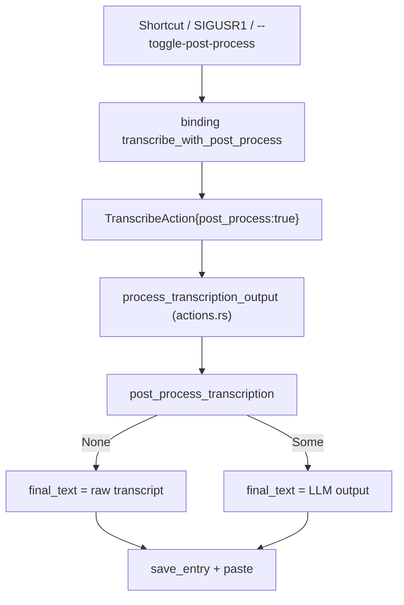

# LLM Post-Processing

Covers: src-tauri/src/llm_client.rs, src-tauri/src/apple_intelligence.rs, src-tauri/swift/**, src-tauri/build.rs, src-tauri/src/actions.rs, src-tauri/src/settings.rs, src-tauri/src/shortcut/mod.rs, src/components/settings/post-processing/**, src/components/settings/PostProcessingSettingsApi/\*\*, src/components/settings/PostProcessingToggle.tsx

Optional step that sends the transcript to a user-configured LLM to clean it up. Off by default. Any failure falls back to the raw transcript. Pipeline context: [recording-and-transcription.md](recording-and-transcription.md); stored result: [history.md](history.md); settings plumbing: [settings.md](settings.md); conventions: [backend](../guides/backend-conventions.md), [frontend](../guides/frontend-conventions.md).

## How it plugs in

- Two actions in `actions.rs`: `transcribe` (`post_process: false`) and `transcribe_with_post_process` (`true`). The second binding is only registered while `post_process_enabled` is true (`resume_all_shortcuts`, `handy_keys.rs`, `change_post_process_enabled_setting`, which also registers/unregisters it live).
- `--toggle-post-process` (`cli.rs`, handled in the single-instance callback in `lib.rs`) and `SIGUSR1` (`signal_handle.rs`) call `send_transcription_input(app, "transcribe_with_post_process", ...)`. These do not check `post_process_enabled`; only shortcut registration does.
- `process_transcription_output` is also used by history re-transcribe (`commands/history.rs`).
- `post_process_transcription` returns `None` (raw text kept) when: transcript blank, no active provider, empty model for that provider, no selected prompt (`post_process_selected_prompt_id` defaults to `None`), prompt not found or empty, request error. Each logs at debug/error.
- History stores `post_processed_text` and the prompt text only when post-processing produced output; `post_process_requested` records the user's intent.
- Overlay shows a "processing"/polishing state during the call; the call is cancellable via `complete_unless_cancelled`.

## Request path (`llm_client.rs`)

| Aspect          | Detail                                                                                                                                                                                                                                                                                                                                  |
| --------------- | --------------------------------------------------------------------------------------------------------------------------------------------------------------------------------------------------------------------------------------------------------------------------------------------------------------------------------------- | ------------------------------------------------------------------------------------------ |
| Endpoint        | `{base_url}/chat/completions` (trailing `/` trimmed), non-streaming. Models: `GET {base_url}/models` (`fetch_models`; handles `{data:[{id                                                                                                                                                                                               | name}]}`or a plain string array; ignores`models_endpoint`'s value, only `/models` is used) |
| Headers         | `Content-Type`, `Referer`/`User-Agent`/`X-Title` identifying TypeVocal; auth `Authorization: Bearer <key>`, except provider id `anthropic` which uses `x-api-key` + `anthropic-version`. Key header omitted when empty (custom/local)                                                                                                   |
| Structured mode | Used when `provider.supports_structured_output`. System message = prompt with `${output}` removed; user message = transcript; `response_format` json_schema `transcription_output` (strict) with a single `transcription` string field. Response JSON is parsed in `actions.rs`; parse failure or missing field returns the raw content |
| Fallback        | Structured request error falls through to legacy mode                                                                                                                                                                                                                                                                                   |
| Legacy mode     | Single user message: prompt with `${output}` replaced by the transcript                                                                                                                                                                                                                                                                 |
| Reasoning off   | `disable_reasoning` is true only for provider ids `custom` and `openrouter`. Field varies: DeepSeek base URL gets `thinking:{type:disabled}`, OpenRouter gets `reasoning:{effort:none,exclude:true}`, others `reasoning_effort:"none"`. A 400/422 triggers one retry without them; rejection is cached per `base_url                    | model` in a process-wide set                                                               |
| Output cleanup  | `strip_think_block` (leading `<think>...</think>`), `strip_invisible_chars` (U+200B/C/D, U+FEFF)                                                                                                                                                                                                                                        |

Error text goes through `report_reqwest_error`/`sanitized_url*` to avoid logging secrets and payloads. Keep that when editing.

## Providers (`default_post_process_providers` in `settings.rs`)

| id                                        | Base URL                                      | Structured |
| ----------------------------------------- | --------------------------------------------- | ---------- |
| `openai` (default)                        | `https://api.openai.com/v1`                   | yes        |
| `zai`                                     | `https://api.z.ai/api/paas/v4`                | yes        |
| `openrouter`                              | `https://openrouter.ai/api/v1`                | yes        |
| `anthropic`                               | `https://api.anthropic.com/v1`                | no         |
| `groq`                                    | `https://api.groq.com/openai/v1`              | no         |
| `cerebras`                                | `https://api.cerebras.ai/v1`                  | yes        |
| `apple_intelligence` (macOS aarch64 only) | `apple-intelligence://local`                  | yes        |
| `bedrock_mantle`                          | `https://bedrock-mantle.us-east-1.api.aws/v1` | yes        |
| `custom`                                  | `http://localhost:11434/v1`, editable         | no         |

- Everything is OpenAI chat-completions shaped; Anthropic only differs in auth headers.
- `ensure_post_process_defaults` runs on settings load: adds missing providers, key/model slots, syncs `supports_structured_output` from code, fills the Apple default model. New provider = add to this list; existing stores pick it up on next load.
- Base URL is editable only for `custom`; `change_post_process_base_url_setting` rejects others.

## Settings fields (`AppSettings`)

`post_process_enabled`, `post_process_provider_id`, `post_process_providers: Vec<PostProcessProvider>`, `post_process_api_keys: SecretMap` (per provider id; `Debug` redacts non-empty values; never log values), `post_process_models: HashMap<provider id, model>`, `post_process_prompts: Vec<LLMPrompt{id,name,prompt}>`, `post_process_selected_prompt_id: Option<String>`.

- Default prompt `default_improve_transcriptions` ("Improve Transcriptions") uses `${output}` wrapped in `<transcript>` tags.
- Commands (all in `shortcut/mod.rs`, registered in `lib.rs`): `change_post_process_enabled_setting`, `set_post_process_provider`, `change_post_process_{base_url,api_key,model}_setting`, `fetch_post_process_models`, `add/update/delete_post_process_prompt`, `set_post_process_selected_prompt`. Deleting the last prompt is refused; deleting the selected one selects the first remaining.
- `fetch_post_process_models` requires a non-empty key for every provider except `custom` and Apple.

## Apple Intelligence

- Rust FFI: `apple_intelligence.rs` (`check_apple_intelligence_availability`, `process_text_with_system_prompt`) over `@_cdecl` Swift functions in `swift/apple_intelligence.swift` (FoundationModels, macOS 26+), header `apple_intelligence_bridge.h`. Calls are `#[cfg(all(target_os="macos", target_arch="aarch64"))]`; elsewhere the provider returns `None`.
- `build.rs` `build_apple_intelligence_bridge` compiles the real Swift file, or `apple_intelligence_stub.swift` when the toolchain lacks FoundationModels.
- Availability is checked lazily at use time, not at startup (early access crashed on macOS 26 betas).
- Swift tries structured `CleanedTranscript` generation, falls back to plain text. The "model" setting for this provider is repurposed as a token limit: `model.parse::<i32>()`, 0 if not numeric (no limit); the default model string is "Apple Intelligence". The limit truncates output text (`truncatedText`), it is not a generation cap.
- Frontend: selecting it calls `commands.checkAppleIntelligenceAvailable` (`commands/mod.rs`) and shows an "unavailable" notice; the model dropdown is hidden.

## Frontend

- Sidebar entry `postprocessing` (`Sidebar.tsx`) is shown only while `post_process_enabled`. The enable toggle (`PostProcessingToggle.tsx`) lives in `advanced/AdvancedSettings.tsx`.
- `post-processing/PostProcessingSettings.tsx`: API section (provider, base URL for custom, API key, model select with refresh) and prompts section (select/create/edit/delete). State: `PostProcessingSettingsApi/usePostProcessProviderState.ts`; store actions `setPostProcessProvider`, `updatePostProcessSetting` (base_url/api_key/model), `fetchPostProcessModels`, `setPostProcessModelOptions` in `settingsStore.ts`.
- Strings: `settings.postProcessing.*`, toggle under `settings.debug.postProcessingToggle.*`.
