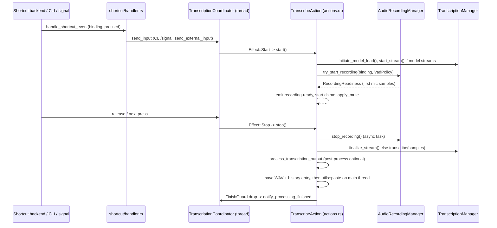
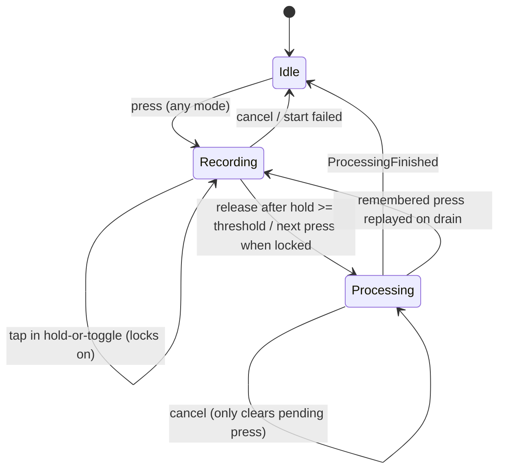

# Recording and Transcription

Covers: src-tauri/src/shortcut/**, src-tauri/src/transcription_coordinator.rs, src-tauri/src/actions.rs, src-tauri/src/managers/audio.rs, src-tauri/src/managers/transcription.rs, src-tauri/src/audio_toolkit/audio/**, src-tauri/src/audio_toolkit/vad/\*\*, src-tauri/src/audio_toolkit/text.rs, src-tauri/src/chinese_script.rs, src-tauri/src/audio_feedback.rs, src-tauri/src/secure_input.rs, src/components/SecureInputWarning.tsx

Trigger (shortcut / CLI / signal) to transcribed text. Output delivery: [paste-and-text-output.md](paste-and-text-output.md). Model loading: [models.md](models.md). LLM polish: [post-processing.md](post-processing.md). Saved entries: [history.md](history.md). Overlay: [tray-and-overlay.md](tray-and-overlay.md). CLI/signals: [cli-and-remote-control.md](cli-and-remote-control.md). Conventions: [backend](../guides/backend-conventions.md), [frontend](../guides/frontend-conventions.md).

## Pipeline

## Shortcut layer (`src-tauri/src/shortcut/`)

- `mod.rs`: `init_shortcuts` picks the backend from `keyboard_implementation` (default `HandyKeys`, `Tauri` on Linux). If handy-keys init fails it falls back to Tauri and persists that choice.
- `tauri_impl.rs`: `tauri-plugin-global-shortcut`. Needs a non-modifier key, rejects `fn`, rejects duplicate registrations.
- `handy_keys.rs`: own manager thread owning `HotkeyManager`, commands over mpsc. Accepts modifier-only combos and `fn`. Also provides the key-capture recorder for the settings UI.
- Both call `handler::handle_shortcut_event`. Transcribe bindings (`is_transcribe_binding`: `transcribe`, `transcribe_with_post_process`) go to the coordinator. `cancel` runs only while recording and on press. Other bindings (`test`) are plain start/stop.
- `transcribe_with_post_process` is not registered at init when `post_process_enabled` is off.
- The `cancel` binding is registered dynamically per recording (`register_cancel_shortcut` / `unregister_cancel_shortcut`, reconciled async via `CANCEL_REQUESTED`). Disabled on Linux.

## Coordinator (`transcription_coordinator.rs`)

Single thread, mpsc `Command`s (`Input`, `Cancel`, `ProcessingFinished`). All decisions live in the pure `CoordinatorState` (unit-tested without Tauri); `run_effect` executes `Effect::Start/Stop`.

| Mode (`ShortcutActivation`) | Release                                                                     | Next press                        |
| --------------------------- | --------------------------------------------------------------------------- | --------------------------------- |
| `push_to_talk`              | stops                                                                       | n/a                               |
| `toggle`                    | ignored                                                                     | stops (session locked from start) |
| `hold_or_toggle` (default)  | held >= `hold_threshold_ms` (default 300) stops, shorter locks recording on | stops when locked                 |

- Releases are deferred `RELEASE_GRACE` (50 ms) so an X11 auto-repeat press can cancel them (#1539).
- Physical presses within `DEBOUNCE` (30 ms) are dropped. External triggers (`send_external_input`, from SIGUSR/CLI) are never debounced and always act as toggle, since dropping one desyncs parity.
- A press while `Processing` is remembered (`PendingPress`) and replayed when the pipeline drains; two toggle presses net to a no-op.
- `on_start_result` rolls back to `Idle` if `is_recording()` is false after `start`.
- UI: `src/components/settings/ShortcutActivation.tsx`; threshold slider is in the debug page (`settings/debug/HoldThreshold.tsx`).

## Actions (`actions.rs`)

- `ACTION_MAP`: `transcribe`, `transcribe_with_post_process` (`TranscribeAction { post_process }`), `cancel`, `test`.
- `start`: kicks off ASR load plus `preload_vad` in parallel, aborts (no mic) if no model can transcribe, sets tray/overlay, chooses `VadPolicy` (`Disabled` if `vad_enabled` off, `Streaming` if the model `supports_streaming`, else `Offline`), calls `try_start_recording`. Failure emits `recording-error` (`microphone_permission_denied` / `no_input_device` / `unknown`); `src/App.tsx` shows a toast.
- Start chime plays only after the first real mic samples (`RecordingReadiness::wait`), then `emit_recording_ready` and `apply_mute`.
- `stop`: unregisters cancel, `remove_mute`, plays stop sound, then async: `stop_recording`, WAV save (`spawn_blocking`) concurrent with transcription, WAV verify, history save, paste via `run_on_main_thread`. Empty text skips paste. A transcription error emits `transcription-error` and still saves an entry with empty text so it can be retried.
- Every step re-checks `was_cancelled_since(cancel_generation)`. `FinishGuard` (Drop) always unloads-if-immediate and notifies the coordinator.

## Audio capture

- `managers/audio.rs`: `RecordingState` Idle/Recording/Stopping; `MicrophoneMode` `AlwaysOn` (`always_on_microphone`) or `OnDemand` (stream opened per recording; `lazy_stream_close` keeps it warm `STREAM_IDLE_TIMEOUT` 30 s).
- Device choice (`desired_microphone`): `clamshell_microphone` when the lid is closed, else `selected_microphone`, else system default. A missing selected mic falls back to default and rewrites the setting (`persist_default_microphone_after_fallback`). Resolved device is cached; invalidate with `invalidate_device_cache`.
- `audio_toolkit/audio/recorder.rs` captures with cpal, averages channels or takes `selected_channel`, resamples to 16 kHz mono in 30 ms frames (`resampler.rs`, rubato `FrameResampler`), emits level data to the UI, and feeds frames to `StreamRouter`.
- `stop_recording` waits `extra_recording_buffer_ms` (cancellable), and pads clips shorter than 1 s to 1.25 s of zeros.
- `mute_while_recording` mutes system audio per-OS (`set_mute`), restoring the prior mute state.

## VAD (`audio_toolkit/vad/`)

- Backends via `VadBackend` (`Silero` default, ONNX file `resources/models/silero_vad_v4.onnx`, threshold 0.3; `Earshot`, threshold 0.5). Both wrapped by `SmoothedVad`.
- Timings in ms (`vad/mod.rs`): prefill 450, onset 60, hangover 450 offline / 1650 streaming; converted to frames per backend (`frames_for_duration_ms`).
- `update_vad_backend` swaps the detector while idle and reopens a warm stream.

## Transcription (`managers/transcription.rs`)

- `transcribe(Vec<f32>)` waits on in-flight model load, then runs transcribe-cpp (`transcribe_cpp`) or ONNX (`transcribe_onnx`). Language is resolved per model by `effective_language_for_model` (never written back to settings); `translate_to_english` is honored only if the model supports it.
- Custom words: whisper-arch models get them as `initial_prompt`; other models get fuzzy `apply_custom_words` (`audio_toolkit/text.rs`, threshold `word_correction_threshold`).
- `post_process_transcription_text` order: Chinese script conversion (`chinese_script.rs`, only when output is Chinese) -> custom words -> `remove_filler_words` -> `normalize_transcription_output`. Fail-open on error. Do not confuse with LLM post-processing in `actions.rs`.
- Streaming: `start_stream` spawns a worker; recorder frames flow through `StreamRouter.feed`; `finalize_stream` returns text, and an empty result falls back to batch `transcribe`. Events: `StreamTextEvent {committed, tentative}`, `StreamPhaseEvent {phase, kind}` (`Transcribing`/`Polishing`).

## Cancel

`utils::cancel_current_operation` (called by the `cancel` binding, tray item, `--cancel`): unregisters cancel shortcut, `cancel_recording` (bumps `cancel_generation`, discards audio), `cancel_stream`, `cancel_transcription`, resets tray/overlay, unloads model if immediate-unload, then `notify_cancel`.

## Feedback sounds and files

- `audio_feedback.rs`: `play_feedback_sound` (async thread) and `_blocking` (start chime). Gated by `audio_feedback`; volume `audio_feedback_volume`; output device `selected_output_device`; `SoundTheme::Custom` reads `custom_start.wav` / `custom_stop.wav` from app data, others from bundled resources.
- Recordings: `<app_data>/recordings/typevocal-<ts>.wav` owned by `HistoryManager` (see [history.md](history.md)).

## macOS Secure Input (`secure_input.rs`, `SecureInputWarning.tsx`)

- Secure Input blocks the handy-keys event tap. A 1 s monitor (`SUSTAIN_THRESHOLD` 3 s) marks it "sustained", then shadow-registers keyed bindings through Carbon (Tauri plugin) as a fallback, only when `keyboard_implementation == HandyKeys`.
- Modifier-only and mouse bindings are immune. Side-specific modifiers widen to both sides (degraded). `fn` bindings cannot be covered. Cancel has its own fallback.
- Emits `secure-input-changed`; `get_secure_input_status` and `run_keyboard_diagnostic` are commands. The banner (mounted in `App.tsx`) only shows when bindings are degraded/uncovered or the shortcut recorder was blocked. Non-macOS `imp` is a no-op.
