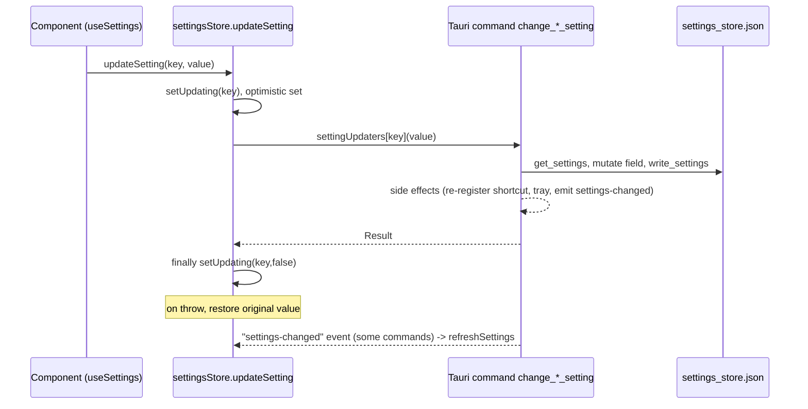

# Settings

Covers: src-tauri/src/settings.rs, src-tauri/src/shortcut/mod.rs, src-tauri/src/commands/mod.rs, src-tauri/resources/default_settings.json, src/stores/settingsStore.ts, src/hooks/useSettings.ts, src/components/Sidebar.tsx, src/components/settings/\*\*

One `AppSettings` struct in Rust is the single source of truth. The frontend holds a Zustand mirror and calls one Tauri command per setting. Conventions: [backend](../guides/backend-conventions.md), [frontend](../guides/frontend-conventions.md). Feature-specific settings: [paste-and-text-output.md](paste-and-text-output.md), [models.md](models.md), [post-processing.md](post-processing.md), [history.md](history.md).

## Backend model (`settings.rs`)

- `AppSettings` (`#[serde(default)]`, derives `specta::Type`, so `src/bindings.ts` mirrors it). Container-level default means missing fields fall back to `get_default_settings()`.
- Store: tauri-plugin-store file `settings_store.json` (`SETTINGS_STORE_PATH`, resolved via `portable::store_path`), single key `"settings"`. There is no cache: `get_settings(app)` re-reads the store each call; `write_settings(app, settings)` does `store.set` (whole struct). Pattern in every command: `get_settings` -> mutate one field -> `write_settings`.
- `get_settings` also repairs on read: if deserialize fails, `salvage_settings` keeps every individually valid field (one bad field never resets the rest); `apply_settings_migrations` runs one-time migrations; missing default bindings are merged in; `ensure_post_process_defaults` syncs providers. Any change is written back.
- Migrations are guarded by absent keys in the stored JSON (onboarding_completed, whats_new_last_seen_version, shortcut_activation from legacy `push_to_talk`, chinese_script from `zh-Hans/zh-Hant`, overlay_style from `overlay_position: "none"`) plus `settings_schema_version` (`CURRENT_SETTINGS_SCHEMA_VERSION = 2`, resets `transcribe_gpu_device`). Add new one-time logic here, keyed on a missing key or the schema version.
- Adding a field: struct field + `default_*` fn + entry in `get_default_settings()` + (if user-editable) a change command + `settingUpdaters` entry. Tests in `settings.rs` build a stored JSON fixture; keep it in sync if a field has no default.
- `src-tauri/resources/default_settings.json` is NOT read by any Rust or TS code (stale, still lists `push_to_talk`). Defaults come from `get_default_settings()` via `commands::get_default_settings`.
- Updater lock: env `TYPEVOCAL_DISABLE_UPDATER` (read once, `update_checks_forced_disabled`) forces update checks off without touching the stored `update_checks_enabled`; use `update_checks_effectively_enabled(&settings)`. Frontend reads it through `isUpdateChecksLocked` -> `updateChecksLocked`. Inconsistency: `AGENTS.md` and two i18n strings (zh, zh-TW) still say `HANDY_DISABLE_UPDATER`; the code only reads `TYPEVOCAL_DISABLE_UPDATER`.

## One setting change

## Frontend

- `settingsStore.ts`: `initialize()` loads `getDefaultSettings`, `getAppSettings`, custom sounds, update lock in parallel; audio devices are deliberately loaded later from `App.tsx` (avoids early macOS permission prompt). Listens to `model-state-changed` and `settings-changed` and calls `refreshSettings()` (backend is source of truth).
- `settingUpdaters`: map `keyof Settings` -> command call. A key with no updater logs `No handler for setting` (except `bindings`, `selected_model`, which have their own flows). New setting without an entry silently does not persist.
- Gotcha: rollback only happens when the updater throws. Generated `commands.*` return `{status:"error"}` instead of throwing, so most failed updates keep the optimistic value. Only updaters that explicitly `throw` (e.g. `selected_channel`, `vad_backend`, which also toasts) roll back.
- `resetSetting(key)` writes `defaultSettings[key]` through `updateSetting`. `updateBinding`/`resetBinding` handle shortcuts. Post-process provider/key/model helpers are separate store actions (see post-processing.md).
- `useSettings()` is the only hook components use: `getSetting`, `updateSetting`, `isUpdating(key)`, `resetSetting`, `refreshSettings`, device lists, post-process helpers. Calls `initialize()` on first mount.
- UI components: `SettingContainer`/`SettingsGroup` + a small component per setting in `src/components/settings/` (strings under `settings.*` i18n keys).

## Change commands

- Most live in `shortcut/mod.rs` as `change_*_setting` (named for historical reasons, not only shortcuts), some in `commands/mod.rs` (`set_log_level`, `open_*`, getters) and `commands/audio.rs` (`update_microphone_mode`, `set_selected_microphone`, `set_selected_channel`). All are `#[tauri::command] #[specta::specta]` and registered in `lib.rs`.
- Ones with side effects: `change_post_process_enabled_setting` (shortcut register), `change_keyboard_implementation_setting` (re-registers shortcuts, emits `settings-changed`), `change_app_language_setting` (tray menu), `change_theme_setting` (emits `theme-changed`), `change_debug_mode_setting` (see below), `update_history_limit` / `update_recording_retention_period` (history cleanup).

## Setting groups

| Group           | Edited in (sidebar section)           | Main `AppSettings` fields                                                                                                                                                                                                                                                    |
| --------------- | ------------------------------------- | ---------------------------------------------------------------------------------------------------------------------------------------------------------------------------------------------------------------------------------------------------------------------------- |
| Shortcuts       | General                               | `bindings`, `shortcut_activation`, `hold_threshold_ms` (debug), `keyboard_implementation` (Advanced)                                                                                                                                                                         |
| Audio           | General, Debug                        | `selected_microphone`, `selected_channel`, `clamshell_microphone`, `selected_output_device`, `always_on_microphone`, `mute_while_recording`, `audio_feedback*`, `sound_theme`, `extra_recording_buffer_ms`                                                                   |
| Model/language  | General, Models, Advanced             | `selected_model`, `selected_language`, `translate_to_english`, `chinese_script`, `model_unload_timeout`, `transcribe_accelerator`, `ort_accelerator`, `transcribe_gpu_device` (see models.md)                                                                                |
| VAD             | Advanced                              | `vad_enabled`, `vad_backend`                                                                                                                                                                                                                                                 |
| Text processing | Advanced, Debug                       | `custom_words`, `word_correction_threshold`, `filler_word_removal_enabled`, `custom_filler_words`, `append_trailing_space`                                                                                                                                                   |
| Paste/output    | Advanced, Debug                       | `paste_method`, `typing_tool`, `external_script_path`, `clipboard_handling`, `auto_submit(_key)`, `paste_delay_*`, `reliable_paste` (see paste-and-text-output.md)                                                                                                           |
| Post-processing | Advanced toggle, Post Process section | `post_process_*`                                                                                                                                                                                                                                                             |
| History         | Advanced, History                     | `history_limit`, `recording_retention_period`                                                                                                                                                                                                                                |
| App behavior    | Advanced, About, Debug                | `start_hidden`, `autostart_enabled`, `show_tray_icon`, `overlay_position`, `overlay_style`, `lazy_stream_close`, `experimental_enabled`, `update_checks_enabled`, `show_whats_new_on_update`, `whats_new_last_seen_version`, `app_language`, `theme`, `onboarding_completed` |
| Diagnostics     | Debug                                 | `debug_mode`, `log_level`                                                                                                                                                                                                                                                    |
| Internal        | none                                  | `settings_schema_version`                                                                                                                                                                                                                                                    |

`overlay_position` (top/bottom) and `overlay_style` are both edited in `ShowOverlay.tsx`; legacy `overlay_position: "none"` migrates to `overlay_style: none`.

## Sidebar and debug mode

- `SECTIONS_CONFIG` in `Sidebar.tsx`: `general`, `history`, `models`, `advanced`, `postprocessing` (visible only when `post_process_enabled`), `debug` (visible only when `debug_mode`), `about`. Section components: `general/GeneralSettings`, `advanced/AdvancedSettings`, `debug/DebugSettings`, `about/AboutSettings`, `history/HistorySettings`, `models/ModelsSettings`, `post-processing/PostProcessingSettings`.
- Debug toggle: `Ctrl/Cmd+Shift+D` keydown listener in `App.tsx` calls `updateSetting("debug_mode", !current)`. `change_debug_mode_setting` persists it, flips `crate::WEBVIEW_LOG_STREAMING` (live log viewer only streams while on) and emits `settings-changed {setting:"debug_mode"}`.
