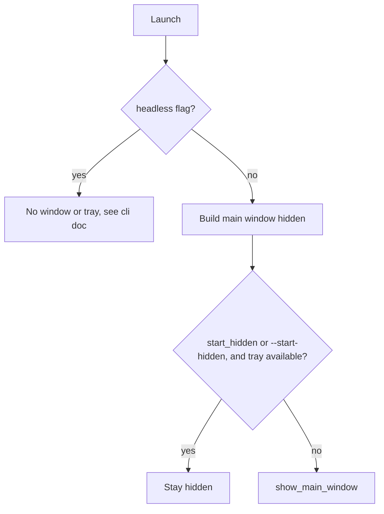

# Tray, Overlay and Window Lifecycle

Covers: src-tauri/src/tray.rs, src-tauri/src/tray*i18n.rs, src-tauri/build.rs, src-tauri/resources/tray*\*.png, src-tauri/src/overlay.rs, src/overlay/, src-tauri/src/autostart.rs, src-tauri/src/lib.rs

Conventions: [backend](../guides/backend-conventions.md), [frontend](../guides/frontend-conventions.md). Settings mechanics: [settings.md](settings.md).

## Tray

Built once in `lib.rs::initialize_core_logic` (`TrayIconBuilder`), stored as managed state, then driven only through `tray.rs`.

| Entry point                                            | Use when                                                                                 |
| ------------------------------------------------------ | ---------------------------------------------------------------------------------------- |
| `set_tray_state(app, TrayIconState)`                   | Idle / Recording / Transcribing changed                                                  |
| `refresh_tray_icon` / `update_tray_menu` / `sync_tray` | Theme, Secure Input warning, models, language or settings changed (all call `sync_tray`) |
| `set_tray_visibility`, `recreate_tray_icon` (macOS)    | Bypass the applier; call the tray directly                                               |

`utils.rs` re-exports `tray::*` and `overlay::*`.

**Desired-state applier.** Callers only record intent. `compute_desired` snapshots settings and manager state on the calling thread (the main thread must not take manager locks, #1716). `apply_on_main` then diffs against `applied_icon` / `applied_menu` and touches the native tray only for what changed. Requests coalesce (`pending`), stale ones are dropped (`next_seq` / `desired_seq`), and a part is marked applied only if its native call succeeded. Never call `tray.set_icon` / `set_menu` elsewhere: re-showing a hidden tray relies on the last applied values.

**Menu.** `build_menu` builds one of two layouts: busy (Recording or Transcribing, shows Cancel) or idle (model submenu with `model_select:<id>` items, Unload Model). Both have version line, Copy Last Transcript, Settings, Check for Updates, Quit. The Secure Input warning item is inserted at index 2 (macOS). Check for Updates is removed entirely when `settings::update_checks_forced_disabled()` is true and disabled-but-visible when only the setting is off. Click handling is the `on_menu_event` match in `lib.rs`, keyed by item id.

**Click behaviour.** Windows: left click or double click opens the main window, right click opens the menu. macOS and Linux: left click opens the menu.

### Icons and themes

`get_icon_path(AppTheme, TrayIconState, warning)` returns `resources/tray_*.png`. All are loaded as template images.

| Theme   | Source              | Files                                                                            |
| ------- | ------------------- | -------------------------------------------------------------------------------- |
| Dark    | macOS/Windows dark  | `tray_idle`, `tray_recording`, `tray_transcribing` (light glyphs)                |
| Light   | macOS/Windows light | same names with `_dark` suffix                                                   |
| Colored | Linux always        | `tray_idle_colored.png`, `resources/recording.png`, `resources/transcribing.png` |

Warning badge applies only to Idle: `tray_idle_warning(.png|_dark.png)`. A unit test checks every combination resolves to a real file. On Windows the theme comes from the registry `SystemUsesLightTheme` (taskbar theme), not the window theme. `WindowEvent::ThemeChanged` calls `refresh_tray_icon`.

### Tray translations

`tray_i18n.rs` does `include!` of `$OUT_DIR/tray_translations.rs`, generated by `build.rs::generate_tray_translations` from the `"tray"` object of every `src/i18n/locales/*/translation.json`.

- English keys define the `TrayStrings` fields (camelCase to snake_case). Missing keys in other locales become `""`, so `build_menu` falls back to English for `secure_input_warning`; do the same for new keys if blanks matter.
- Lookup: exact locale, then Chinese script fallback (`zh` / `zh-TW`), then language code, then `en`.
- New menu item: add key to `en` and other locales, then use `strings.<field>` in `build_menu`.

## Recording overlay

Separate webview window labelled `recording_overlay`, created at boot (hidden) by `create_recording_overlay`, URL `src/overlay/index.html`. Two impls: macOS builds an NSPanel (`tauri_nspanel`, status level, non-activating, joins all spaces); other platforms use a frameless, transparent, always-on-top, unfocusable `WebviewWindowBuilder`. Non-Linux skips creation if no monitor position can be computed.

- Settings: `OverlayStyle` (`None`, `Minimal`, `Live`) decides whether it shows; `OverlayPosition` (`Top`, `Bottom`) only picks placement. Default style is `None` on Linux, `Live` elsewhere; legacy `overlay_position: "none"` migrates to style `None`.
- States (event payload of `show-overlay`): `recording`, `streaming`, `transcribing`, `processing`. `streaming` uses the large 400x120 window, others 256x50. Style `Live` plus a streaming-capable model chooses streaming (`actions.rs`).
- Backend to frontend events: `show-overlay`, `hide-overlay` (window actually hides 300 ms later; `OVERLAY_SHOW_GENERATION` cancels a stale hide), `recording-ready`, `mic-level` (throttled to ~30 FPS, skipped when `OVERLAY_ENABLED` is false; cache updated by `update_overlay_enabled_cache`), plus `streamTextEvent`, `streamPhaseEvent`, `model-state-changed`.
- Geometry runs on the main thread (`run_on_main_thread`); doing it elsewhere crashed on Linux (#227). The overlay follows the monitor under the cursor.
- Offsets: top 46 (macOS) / 4 (others); bottom 15 (macOS) / 40 (others).
- Windows: `force_overlay_topmost` re-asserts topmost after show and bounds are re-applied after `show()` (DPI reflow).
- `src/overlay/main.tsx` applies the theme itself (separate webview) and `RecordingOverlay.tsx` re-reads `overlay_position` on every show.

### Linux GTK layer shell

`init_gtk_layer_shell` runs after window creation. It is skipped if `TYPEVOCAL_NO_GTK_LAYER_SHELL` is truthy or `gtk_layer_shell::is_supported()` is false, in which case a regular window is used (`LAYER_SHELL_ACTIVE` false). When active, position and size use anchors/margins (`configure_layer_shell_surface`), not `set_position`. Inconsistency: `AGENTS.md` names `HANDY_NO_GTK_LAYER_SHELL`; the code reads `TYPEVOCAL_NO_GTK_LAYER_SHELL`. See also [Linux runbook](../runbooks/linux.md).

## Main window, single instance, autostart

- `tray_available = settings.show_tray_icon && !cli_args.no_tray`. With no tray the window always shows (macOS: Dock is the only way back, #903). `--no-tray` hides the tray via `set_tray_visibility`; it is runtime only.
- Window close is intercepted: `prevent_close` plus `hide()`. On macOS with a tray the activation policy goes to Accessory (no Dock icon); `show_main_window` sets it back to Regular. A hidden-start launch on macOS sets Accessory between `build()` and `run()` (`apply_startup_activation_policy`, #1787); do not move it into `setup`.
- Single instance (`tauri_plugin_single_instance`, skipped in headless mode): a second launch with a remote flag acts on the running app (see [cli-and-remote-control.md](cli-and-remote-control.md)); otherwise it calls `recreate_tray_icon` (macOS) and `show_main_window`. macOS relaunch from Finder/Dock arrives as `RunEvent::Reopen` and does the same (tray recreated only if the window was hidden; macOS tray vanish bug #1948).
- Windows: if mic permission is denied and a model is downloaded, `should_force_show_permissions_window` forces the window visible even when start-hidden.
- Autostart: `autostart::apply_autostart(app, settings.autostart_enabled)` runs on every launch and on `change_autostart_setting`. macOS 13+ uses `SMAppService` (`objc2_service_management`) and deletes the legacy `~/Library/LaunchAgents/<app>.plist`; every other case uses `tauri_plugin_autostart` (`MacosLauncher::LaunchAgent`). Errors are logged, not returned; registration fails in unsigned dev builds.
