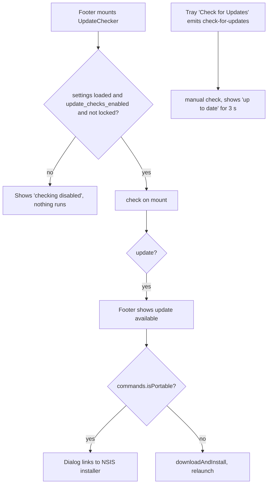

# Updates, Release Notes and Release Workflows

Covers: src-tauri/tauri.conf.json, src/components/update-checker/, src/components/whats-new/, src/content/release-notes/, src-tauri/src/settings.rs, .github/workflows/release.yml, .github/workflows/build.yml, .github/workflows/main-build.yml, .github/workflows/pr-test-build.yml, .github/workflows/build-test.yml

Conventions: [frontend](../guides/frontend-conventions.md), [backend](../guides/backend-conventions.md). Build setup: [BUILD.md](../../BUILD.md). Settings mechanics: [settings.md](settings.md). Do not run release or signing workflows (see `CLAUDE.md`).

## Self-updater

- Backend: `tauri_plugin_updater` is registered in `lib.rs` with no custom logic; capability `updater:default` is in `src-tauri/capabilities/default.json`.
- Config (`tauri.conf.json`): `bundle.createUpdaterArtifacts: true`, `plugins.updater.pubkey` (public key) and one endpoint, `https://github.com/masnun-siam/typevocal/releases/latest/download/latest.json`. The manifest is expected as a release asset; `release.yml` does not set it explicitly, so it comes from `tauri-apps/tauri-action` defaults (not verified in this repo).
- Frontend: all checking is in `UpdateChecker.tsx` (mounted in `src/components/footer/Footer.tsx`). It uses `@tauri-apps/plugin-updater` `check()`, `downloadAndInstall` with a progress bar, then `relaunch()`.

### Disabling updates

| Mechanism                                                                                                      | Effect                                         |
| -------------------------------------------------------------------------------------------------------------- | ---------------------------------------------- |
| Setting `update_checks_enabled` (default true; toggle in Debug Settings)                                       | Persisted user preference                      |
| Env `TYPEVOCAL_DISABLE_UPDATER` (read once, `settings::update_checks_forced_disabled`; set by the Nix package) | Forces off without touching the stored setting |

- Backend must use `settings::update_checks_effectively_enabled(&settings)`, never the raw field (used by the tray item and `trigger_update_check`).
- Frontend gets the lock through `commands.isUpdateChecksLocked` into `useSettings().updateChecksLocked`; on error it fails open (`false`). `UpdateChecker` waits for it (`null` = unknown) before the first check.
- Tray: the Check for Updates item is greyed when the setting is off, removed when forced off. Tray click shows the main window and emits `check-for-updates`.

### Portable installs

`installUpdate` calls `commands.isPortable()`; portable builds cannot self-update, so a dialog opens instead. `portableInstaller.ts::resolvePortableInstallerUrl` reads `Update.rawJson.platforms["windows-<arch>-nsis"].url`; anything else (non-Windows, missing entry) falls back to `PORTABLE_RELEASES_URL` (the GitHub releases/latest page) and the dialog text switches to "browse". Tests: `portableInstaller.test.ts`. See [portable-mode.md](portable-mode.md).

## What's New

- Notes are Markdown files `src/content/release-notes/<x.y.z>.md` (rules and image paths in that folder's `README.md`; images under `public/release-notes/<version>/`). `releaseNotes.ts` loads them with `import.meta.glob(... ?raw)`; files whose name is not a version are ignored.
- `WhatsNewGate` (rendered in `App.tsx` only on the main app screen, not during onboarding) calls `findReleaseNoteToShow({currentVersion, lastSeenVersion})`: highest note with `version <= running app version` and `> whats_new_last_seen_version` (if the stored value is not a valid version, any note at or below current qualifies). Dismiss stores `whats_new_last_seen_version = note.version`.
- Settings: `show_whats_new_on_update` (default true; `ShowWhatsNewOnUpdate.tsx`) and `whats_new_last_seen_version`, whose default is `CARGO_PKG_VERSION` at build time, so a fresh install does not see its own version's note. Debug panel `settings/debug/WhatsNewPreview.tsx` uses `findLatestReleaseNote`.
- To ship a note: add `<version>.md` matching the version in `tauri.conf.json`. `src/content/rebrand.test.ts` also scans this content.

## Workflows (`.github/workflows/`)

All build workflows are manual (`workflow_dispatch`); only `ci.yml` runs on push to `main` and on PRs.

| Workflow            | Trigger                   | Produces                                                                                                                                                                                                                                                |
| ------------------- | ------------------------- | ------------------------------------------------------------------------------------------------------------------------------------------------------------------------------------------------------------------------------------------------------- |
| `release.yml`       | manual                    | Creates a draft GitHub release `v<version>` (version read from `tauri.conf.json`, auto-generated notes), then builds 7 targets via `build.yml` with signing on and the Rust cache off; assets attach to the draft. Publishing is a separate manual step |
| `main-build.yml`    | manual                    | Signed builds of all targets from the selected ref; artifacts kept 30 days; concurrency cancels older runs on the same ref                                                                                                                              |
| `pr-test-build.yml` | manual, input `pr_number` | Builds `refs/pull/<n>/merge`, uploads artifacts, then comments download links on the PR                                                                                                                                                                 |
| `build-test.yml`    | manual                    | Same matrix with artifact prefix `handy-test`, artifacts uploaded                                                                                                                                                                                       |
| `build.yml`         | `workflow_call` only      | Reusable: one platform per call; installs toolchains, optionally signs (macOS cert, Windows trusted-signing, Tauri updater key), runs `tauri-apps/tauri-action`, verifies AppImage metadata, uploads artifacts when `upload-artifacts`                  |

Targets in every matrix: macOS arm64 (`macos-26`) and x64, Linux x64 (`.deb` on 22.04; AppImage and rpm on 24.04), Linux arm64, Windows x64 and arm64. Notes:

- `asset-prefix` is still `handy` / `handy-test` / `handy-pr-<n>` (upstream naming left in place).
- The release workflow is the only one that passes `release-id`, which makes `tauri-action` upload to the release.
- Linux builds must keep `gtk-layer-shell` and OpenBLAS verification steps passing (see [Linux runbook](../runbooks/linux.md)).
