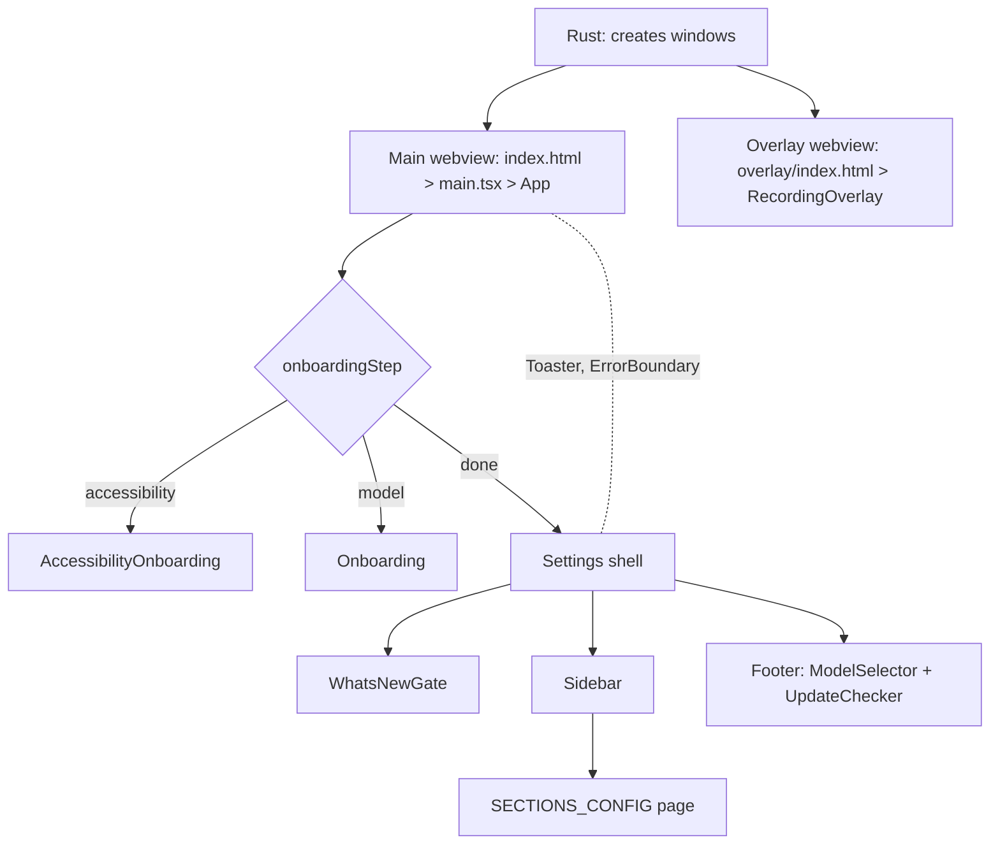
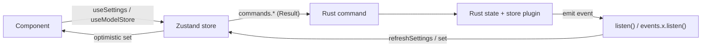

# Frontend structure

Covers: index.html, vite.config.ts, src/main.tsx, src/App.tsx, src/overlay/, src/components/, src/stores/, src/hooks/, src/lib/, src/i18n/, src/content/, src/styles/, src/utils/, src/bindings.ts

Rules (typing, i18n, styling, state-update patterns) live in [guides/frontend-conventions.md](guides/frontend-conventions.md). This doc is the map.

## Windows and entry points

| Window                      | HTML                     | Entry                  | Root component                                |
| --------------------------- | ------------------------ | ---------------------- | --------------------------------------------- |
| Main (settings, onboarding) | `index.html`             | `src/main.tsx`         | `src/App.tsx`                                 |
| Recording overlay           | `src/overlay/index.html` | `src/overlay/main.tsx` | `src/overlay/RecordingOverlay.tsx` (+ `.css`) |

- `vite.config.ts`: two Rollup inputs (`main`, `overlay`), alias `@` to `src/`, dev port 1420 (`strictPort`), ignores `src-tauri/` in watch.
- Windows are created in Rust, not config: `tauri.conf.json` has `"windows": []`. The overlay URL `src/overlay/index.html` is set in `src-tauri/src/overlay.rs`. See [features/tray-and-overlay.md](features/tray-and-overlay.md).
- The two webviews are separate JS contexts: no shared Zustand state. They share `localStorage` (last-known theme) and talk through backend events (`theme-changed`, `show-overlay`, ...).
- `main.tsx` order: `installCompatShims()` (`lib/compat.ts`, `Object.hasOwn` polyfill), set `data-platform`, apply stored theme, `import "./i18n"`, `useModelStore.getState().initialize()`, render `<App/>`.
- `overlay/main.tsx` repeats theme setup and imports `@/i18n` itself, and listens to `theme-changed`.

## App shell (`App.tsx`)

- `onboardingStep`: `null` (renders nothing while checking) > `"accessibility"` > `"model"` > `"done"`. `checkOnboardingStatus` reads `commands.getAppSettings()`; `onboarding_completed` makes the user "returning".
- Returning user: macOS checks accessibility and microphone permission, Windows checks `getWindowsMicrophonePermissionStatus`; a missing permission shows `accessibility` step again (and `showMainWindowCommand`). Otherwise straight to `done`. New user: `accessibility`, then `model`, then `done`. Errors fall back to `accessibility`.
- On first `done`: `commands.initializeEnigo()`, `initializeShortcuts()`, refresh audio and output devices (deliberately not in store `initialize`, to avoid early macOS permission prompts). Details: [features/onboarding-and-permissions.md](features/onboarding-and-permissions.md).
- `currentSection` is plain `useState`, no router. `renderSettingsContent` looks up `SECTIONS_CONFIG[section].component`, falling back to `general`; `debug` is special-cased to pass `onPreviewOnboarding`.
- Onboarding preview (debug section): `onboardingPreview` renders the onboarding components with `preview`, replacing the whole shell.
- `Toaster` (sonner) wraps every step, including onboarding, so toasts are never dropped.
- App-level listeners (raw `listen`): `recording-error`, `paste-error`, `transcription-error`, `model-state-changed` (only `loading_failed`) all become toasts. `Cmd/Ctrl+Shift+D` toggles `debug_mode`.
- Direction: `initializeRTL(i18n.language)` and `dir` on the shell div (`lib/utils/rtl.ts`).

## Navigation (`components/Sidebar.tsx`)

`SECTIONS_CONFIG` is the single source of sections: `labelKey`, `icon`, `component`, `enabled(settings)`. `SidebarSection` is derived from its keys.

| Key              | Component                                         | Visible when           |
| ---------------- | ------------------------------------------------- | ---------------------- |
| `general`        | `settings/general/GeneralSettings`                | always                 |
| `history`        | `settings/history/HistorySettings`                | always                 |
| `models`         | `settings/models/ModelsSettings`                  | always                 |
| `advanced`       | `settings/advanced/AdvancedSettings`              | always                 |
| `postprocessing` | `settings/post-processing/PostProcessingSettings` | `post_process_enabled` |
| `debug`          | `settings/debug/DebugSettings`                    | `debug_mode`           |
| `about`          | `settings/about/AboutSettings`                    | always                 |

Add a page: new component, entry in `SECTIONS_CONFIG`, `sidebar.*` key in every locale. Gotcha: if a section is disabled while active, `App` still renders it (no reset to `general`).

## Component map (`src/components/`)

| Folder                                | Holds                                                                                                                                                                            |
| ------------------------------------- | -------------------------------------------------------------------------------------------------------------------------------------------------------------------------------- |
| `settings/*.tsx`                      | One component per setting, barrel `settings/index.ts`                                                                                                                            |
| `settings/<section>/`                 | Page components listed above; `general/ModelSettingsCard`; `debug/` tools (log viewer, paths, onboarding/what's-new previews); `history/clipboard.ts`                            |
| `settings/PostProcessingSettingsApi/` | Provider/key/model fields + `usePostProcessProviderState`                                                                                                                        |
| `ui/`                                 | Primitives (`SettingContainer`, `SettingsGroup`, `Dropdown`, `Button`, ...)                                                                                                      |
| `shared/`                             | `ProgressBar` only                                                                                                                                                               |
| `model-selector/`                     | Footer model picker, download progress ([features/models.md](features/models.md))                                                                                                |
| `onboarding/`                         | `AccessibilityOnboarding`, `Onboarding` (model pick), `ModelCard`                                                                                                                |
| `update-checker/`                     | `UpdateChecker`, `portableInstaller.ts` ([features/updates-and-release-notes.md](features/updates-and-release-notes.md), [features/portable-mode.md](features/portable-mode.md)) |
| `whats-new/`                          | `WhatsNewGate` > `WhatsNewModal` > `MarkdownContent`; `releaseNotes.ts` picks the note                                                                                           |
| `footer/`                             | `Footer` mounts `ModelSelector` and `UpdateChecker`                                                                                                                              |
| `icons/`                              | SVG components incl. `TypeVocalMark`/`Wordmark`; legacy `HandyHand`/`HandyTextLogo` still used by `Sidebar`                                                                      |
| root                                  | `Sidebar`, `ErrorBoundary`, `AccessibilityPermissions`, `SecureInputWarning`                                                                                                     |

Feature behaviour: [features/settings.md](features/settings.md), [features/history.md](features/history.md), [features/post-processing.md](features/post-processing.md), [features/recording-and-transcription.md](features/recording-and-transcription.md), [features/paste-and-text-output.md](features/paste-and-text-output.md), [features/cli-and-remote-control.md](features/cli-and-remote-control.md).

## State

| Store              | File                                                     | Holds                                                                                                                                                              |
| ------------------ | -------------------------------------------------------- | ------------------------------------------------------------------------------------------------------------------------------------------------------------------ |
| `useSettingsStore` | `stores/settingsStore.ts`                                | `settings`, `defaultSettings`, `isLoading`, per-key `isUpdating`, `audioDevices`, `outputDevices`, `customSounds`, `postProcessModelOptions`, `updateChecksLocked` |
| `useModelStore`    | `stores/modelStore.ts` (immer + `subscribeWithSelector`) | `models`, `currentModel`, downloading/verifying/extracting sets (as `Record<id,true>`), `downloadProgress`, `downloadStats`, `loading`, `error`, `isRescanning`    |

- Settings init is lazy: `useSettings()` (`hooks/useSettings.ts`) calls `store.initialize()` while `isLoading`. Model store init is eager in `main.tsx`. Only the model store `initialize` registers its event listeners; the settings store registers `model-state-changed` and `settings-changed` (both just call `refreshSettings`; `selected_microphone` also refreshes devices).
- Other hook: `useOsType` (wraps `plugin-os` `type()`).
- Listeners are never unregistered in either store (app-lifetime singletons).

## Backend bridge (`src/bindings.ts`)

- Generated by tauri-specta from `src-tauri/src/lib.rs` on debug builds only (`#[cfg(debug_assertions)]`, writes `../src/bindings.ts`). Release builds do not regenerate it.
- Exports `commands` (async, mostly `Result<T,string>`), `events`, and types (`AppSettings`, `ModelInfo`, `Theme`, ...).
- Only three events are typed in `events`: `historyUpdatePayload`, `streamPhaseEvent`, `streamTextEvent`. All others (`model-*`, `settings-changed`, `recording-error`, `show-overlay`, `mic-level`, ...) use raw `listen<T>("name")`, with payload types hand-written in `lib/types/events.ts` (`ModelStateEvent`, `RecordingErrorEvent` only).

## Other `src/` folders

| Path                          | Notes                                                                                                                                                                               |
| ----------------------------- | ----------------------------------------------------------------------------------------------------------------------------------------------------------------------------------- |
| `lib/utils/`                  | `theme.ts`, `rtl.ts`, `keyboard.ts`, `format.ts`, `modelTranslation.ts` + tests                                                                                                     |
| `lib/constants/languages.ts`  | Transcription language list (used by `LanguageSelector`, `ModelCard`, `ModelsSettings`)                                                                                             |
| `lib/types/events.ts`         | Hand-written event payloads                                                                                                                                                         |
| `utils/dateFormat.ts`         | Stray duplicate home of helpers; used only by `HistorySettings`                                                                                                                     |
| `i18n/`                       | `index.ts` globs `locales/*/translation.json` (26 locales, `en` is source); `languages.ts` metadata; `rebrandLocales*.test.ts`                                                      |
| `content/release-notes/`      | `<version>.md` (0.9.0, 0.9.7 present); loaded via `import.meta.glob(?raw)` in `whats-new/releaseNotes.ts`; images under `public/release-notes/<version>/`; rules in its `README.md` |
| `styles/theme.css`, `App.css` | Palette variables and Tailwind `@theme` (see conventions)                                                                                                                           |
