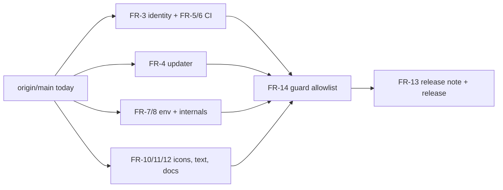

# PRD — Rebrand to TypeVocal

**Status:** Approved · **Date:** 2026-10-14 · **Slug:** `rebrand-to-typevocal` · **Owner:** Siam · **Priority:** high · **Repo:** masnun-siam/typevocal
**Mirror:** 05-Work/TypeVocal/Rebrand to TypeVocal/PRD.md

## Overview

TypeVocal is the owner's fork of the Handy speech-to-text desktop app (Tauri, Rust backend, React frontend). This PRD makes the app read and behave as "TypeVocal" everywhere a user, packager or contributor can see it, with its own icon set, its own app identity and its own release and update channel, while crediting upstream Handy as the origin.

Today:

- Already on `origin/main` (shipped, to be re-verified when tasks are written): crate, binary and CLI name; window title and tray label; package name, page title and in-app release notes; contributor docs; upstream donate and funding links removed; a TypeVocal icon source set (mark and glyph SVGs with a manifest).
- Still Handy on `origin/main`: app product name and bundle identifier (`com.pais.handy`); updater endpoint and signing public key (upstream's); Windows signing command (upstream's Azure account); Linux package paths; installer strings; CI release asset names; Nix package and modules; all `HANDY_*` environment variables; recording file names, portable-mode marker, paste-window class names and LLM request headers; the old logo components and `handy*.png` tray assets; Handy text in all 26 locales; README promo blocks.
- Earlier attempts at several of these were closed unmerged, so the remaining work starts from `origin/main` as it is.
- Does not exist: any guard that stops "Handy" from creeping back.

## Problem

The app still presents itself as someone else's product. Users see Handy in the UI, installers, release assets and updater; the updater would offer upstream Handy builds to TypeVocal users; the owner cannot sign or publish under their own identity. A half-done rename is worse than none because it is inconsistent and hard to audit.

## Users

- **End users** of TypeVocal on macOS, Windows and Linux: see the name, icons, permissions prompts and update notices.
- **Owner/maintainer (Siam):** builds, signs and publishes releases; sets secrets manually.
- **Packagers and contributors:** consume release assets, Nix modules, env vars and docs.

## Goals

- Every user-visible and packaging-visible name is TypeVocal, using one icon set on every icon surface.
- TypeVocal installs side by side with upstream Handy and never offers Handy builds.
- A permanent check makes any unlisted "Handy" mention fail CI.

## Non-goals

- Migrating data from an existing Handy install (settings, history, models); no in-app migration UI.
- Mirroring models to a new host or renaming the third-party model hosting (`blob.handy.computer`, `handy-computer/*` Hugging Face repositories) or the `handy-keys` dependency and its identifiers.
- Redesigning the icon mark; the existing TypeVocal mark is final.
- Redrawing historical release-note screenshots.
- Generating or storing the updater key or signing secrets; the owner sets those manually.
- Windows code signing (unsigned builds until the owner adds their own) and macOS Developer ID signing or notarization (ad-hoc signed; see FR-6 and FR-13).
- Fallback support for old `HANDY_*` variables.
- Removing the old Handy autostart entry from machines that have it.

## Requirements

Status key: **Shipped** = on `origin/main` today; **To do** = needs work. Shipped items stay here so the PRD describes the whole rebrand; no tasks are created for them beyond verification.

- **FR-1 Core names (Shipped).** Crate, binary, library, CLI name and help text, window title, tray version label, log file name, package name, page title and in-app release notes say TypeVocal.
  - Acceptance: `typevocal --help` shows TypeVocal; the window title and tray label read TypeVocal; the log file is `typevocal.log`.
- **FR-2 Contributor docs and funding (Shipped).** Contributor docs target TypeVocal and upstream donate/funding links are gone.
  - Acceptance: no link to upstream funding pages in the repo or the in-app UI.
- **FR-3 App identity.** Product name is `TypeVocal`; bundle identifier is `com.masnunsiam.typevocal`; Linux package install paths, installer (NSIS) strings, window/product strings in packaging use TypeVocal.
  - Acceptance: built macOS app is `TypeVocal.app` with that identifier; Windows installer and Linux deb/rpm/AppImage show TypeVocal and install under TypeVocal paths; a machine with Handy installed runs both without sharing app data or the single-instance lock; the installed deb and rpm launch and transcribe on a clean machine with no Handy present (the package library path and the binary's library search path are renamed together).
- **FR-4 Updater channel.** Updater endpoint is `github.com/masnun-siam/typevocal/releases/latest/download/latest.json` with a new minisign public key slot. A release build without the owner's key configured fails in CI instead of shipping upstream's key.
  - Every update link the app opens, including the portable-mode fallback to the releases page, points at `masnun-siam/typevocal`.
  - Acceptance: the app never contacts or links to `cjpais/Handy`; a release workflow run with the key secret missing fails with a clear message; with the secret present, the produced `latest.json` verifies against the configured public key.
- **FR-5 Release assets.** CI release asset names, artifact prefixes and bundle/binary references use `TypeVocal`/`typevocal`.
  - Acceptance: a tagged release's asset list has no `Handy` in any file name.
- **FR-6 Platform signing config.** The Windows signing command that targets upstream's Azure account is removed, and the release workflow no longer imports upstream's Apple Developer ID or requires any Apple or Azure secret. macOS builds are ad-hoc signed. Updater (minisign) signing is independent of platform code-signing and still runs when those secrets are absent.
  - Acceptance: Windows build completes unsigned with no reference to the upstream account; a release run with no Apple or Azure secrets succeeds on all platforms and still produces a signed `latest.json`.
- **FR-7 Environment variables.** All `HANDY_*` variables (updater disable, Vulkan layers, GTK layer shell, Metal residency, debug, worker and test/build flags) become `TYPEVOCAL_*` with identical meaning. Old names are ignored.
  - Acceptance: setting `TYPEVOCAL_DISABLE_UPDATER=1` locks the updater setting; setting only `HANDY_DISABLE_UPDATER=1` does not; docs, Nix wrapper and CI use the new names.
- **FR-8 Internal names.** Recording file names (`typevocal-*.wav`), the Windows portable-mode marker text, paste-window class names on macOS and Windows, temp script names, autostart entry name, and the HTTP Referer, User-Agent and X-Title sent to LLM providers use TypeVocal and the fork's URL.
  - Acceptance: a recording saves as `typevocal-<timestamp>.wav`; a post-process request carries `X-Title: TypeVocal`; autostart registers under TypeVocal; portable mode works with the new marker.
- **FR-9 Nix.** Package, `pname`, `mainProgram`, flake description and homepage, and modules become `typevocal` (`programs.typevocal`, `services.typevocal`).
  - Acceptance: `nix build` produces `typevocal`; module option paths use `typevocal`; Nix CI check passes.
- **FR-10 Icons everywhere.** One TypeVocal icon set is used on every icon surface: app icons for macOS, Windows (ico and Store/Square logos), Linux, tray icons in themed (light/dark, idle, recording, transcribing, warning) and colored variants, and the in-app logo mark and wordmark in the sidebar and onboarding; the wordmark exposes the accessible name "TypeVocal" and the mark is decorative where the wordmark sits beside it. The old `HandyHand`/`HandyTextLogo` components and `handy*.png` assets are deleted.
  - Acceptance: no file named for Handy remains among icons or tray assets; each tray state in each theme renders the new artwork on a manual pass on each OS; onboarding and sidebar show the TypeVocal logo.
- **FR-11 Locale text.** In all 26 locale files every "Handy" in a value becomes "TypeVocal" (brand name untranslated), including the updater lock hint's variable name. Keys are unchanged.
  - Acceptance: no locale value contains "Handy"; i18n key sets are unchanged and the i18n consistency check passes.
- **FR-12 README and credit.** README, BUILD and other docs say TypeVocal. Upstream sponsor block, Discord badge, Raycast link and upstream discussion links are removed. README states TypeVocal is a fork of Handy by CJ Pais under the MIT license and the license file is kept.
  - Acceptance: README has a fork-credit line linking upstream; none of the removed promo items remain.
- **FR-13 Upgrade note.** README and the release note for the first release with the new identity explain, under a section that opens "If you used Handy before:" so new users can skip it: it is a separate install (a manual fresh install for everyone, including users of earlier TypeVocal builds, which cannot update into it); no data carry-over; models downloaded from Hugging Face live in the shared Hugging Face cache and so are visible to Handy and other tools, and deleting one in either app removes it for all; macOS microphone and accessibility permissions must be re-granted, and because macOS builds are ad-hoc signed Gatekeeper warns on first launch and permissions reset after every update; if Handy is also running both apps may respond to the same global shortcut, so quit Handy or change one app's shortcut; the old Handy login item must be removed by hand; environment variables were renamed from `HANDY_*` to `TYPEVOCAL_*` and the old names are ignored (for example `HANDY_DISABLE_UPDATER` no longer disables the updater). The in-app note is shown on first launch after onboarding. Today a fresh install is stamped as having seen the current version and skips What's New, and every user of this release starts fresh, so this release must show its note even on a fresh install, as a one-time exception to that rule.
  - Acceptance: the section exists in README and in the in-app release notes for that release and covers each item above; on a clean machine the first launch of that release shows the upgrade note after onboarding; the next release follows the normal rule again.
- **FR-14 Leftover guard.** A test run in existing CI fails when a case-insensitive "handy" match appears anywhere in tracked files outside a named allowlist: the license file; the README fork credit and the FR-13 upgrade note; existing historical release notes (listed by file name); the `handy-keys` dependency and its identifiers; the `handy-computer` GitHub organization and `blob.handy.computer` (the transcribe.cpp dependency and model hosting); the patched tao fork branch reference; upstream issue links; and the guard's own allowlist. The ordinary English word "handy" in comments and fixtures is reworded, not allowlisted.
  - Acceptance: adding "Handy" to a UI string makes the check fail; the check passes on the finished rebrand.

Dependency view: independent rename tracks converge on the guard, then the release.

## Edge cases

- **Existing Handy install:** TypeVocal has a new app data directory and single-instance key, so it neither reads nor damages Handy's settings or history; both can run at once and may contend for the same global shortcut (FR-13). Models are the exception: Hugging Face models sit in the user's shared cache, so ones Handy downloaded appear in TypeVocal without a download, and deleting one in either app removes it for both (FR-13).
- **Earlier TypeVocal builds:** they still carry the old identifier and updater, cannot update into the new identity, and require a manual fresh install (FR-13).
- **Failed update check:** keeps current behaviour (logged, no message to the user) as an accepted gap, including before the first `latest.json` is published.
- **Existing data:** none migrated by design; users start fresh.
- **Permissions:** macOS grants are tied to the bundle identity and signature, so mic and accessibility are requested again.
- **Autostart:** a Handy login item stays until removed by the user; TypeVocal registers its own.
- **Updater without key:** release builds fail. Dev builds use the same committed public key; if none is committed, an offered update fails to install with a signature error.
- **Old env vars:** silently ignored; a user who relied on `HANDY_DISABLE_UPDATER` will see the updater enabled until renamed (called out in the FR-13 upgrade note).
- **Guard false positives:** new legitimate matches require an explicit allowlist edit, reviewed in the PR.
- **Concurrency/limits:** not affected; single-user desktop app, no multi-tenancy.
- **Historical content:** old release notes and screenshots may show the old brand; the release notes are allowlisted by file name in FR-14.

## Technical design

### Data

Application data directory is derived from the bundle identifier, so FR-3 moves it to `com.masnunsiam.typevocal` on every platform with no migration (FR-3, FR-13). Settings store, history database, recordings and directly downloaded models are recreated there. Hugging Face models stay in the user's shared cache and are shared with Handy and other tools (FR-13).

### Backend

- Names that are contracts: bundle identifier `com.masnunsiam.typevocal`; env var prefix `TYPEVOCAL_`; updater endpoint above; release asset prefix `TypeVocal_` (FR-3, FR-5, FR-7).
- Updater key: the owner generates a minisign key pair and stores the private key and password as CI secrets; the public key is placed in the app config. CI refuses to build a release when the secret is absent (FR-4).
- Single source for the env var prefix is not required; each reader is renamed in place and the guard (FR-14) catches misses.

### Frontend

Logo mark and wordmark components are replaced by TypeVocal versions generated from the existing SVG source; tray assets are regenerated from the same source in the sizes the tray code loads today (FR-10). Locale values only change (FR-11).

### Integrations and realtime

GitHub Releases is the update source; LLM providers receive the new headers; third-party model hosting is unchanged (non-goal).

### Non-functional

No runtime behaviour change beyond names. Release builds must remain reproducible with the renamed secrets. Windows builds are unsigned; macOS builds are ad-hoc signed.

### Testing

- Unit/automated: guard test (FR-14); locale key parity (FR-11); env var read tests with new names and an assertion old names are ignored (FR-7); portable marker and recording name tests (FR-8); updater config fails fast in CI (FR-4).
- Nix: existing Nix CI job (FR-9).
- Manual, per OS: install, launch, tray states in light/dark, icon in dock/taskbar/installer, permissions prompt, side-by-side with Handy (FR-3, FR-10, FR-13).

## Rollout and cost

All users at once in the first release carrying the new identity. No provider cost. Before release the owner must create the minisign key and set the CI secrets; the first release with the new identity is a manual fresh install for everyone. After it, the update channel is verified end to end on the next release: a build of the identity release is offered the following release and verifies its signature.

## Success metrics

None formally defined beyond: the guard passes in CI and a tagged release's assets, installers and UI contain no unlisted "Handy".

## Epics

- **E1 Complete the TypeVocal rebrand** — covers FR-1 to FR-14. Issue: #43

## Decisions

- Cover the whole rebrand, shipped parts marked Shipped — so the PRD stays the full target while tasks cover only the remainder.
- Bundle identifier `com.masnunsiam.typevocal`, no data migration — fork has no installed base to protect; avoids migration code.
- Updater points at `masnun-siam/typevocal` releases with a new minisign key the owner creates and sets; release builds fail without it — never ship upstream's key.
- Keep third-party model hosting and the `handy-keys` crate unchanged — they are dependencies, renaming breaks downloads.
- Icon set already generated is final; scope is using it on every surface — design is done.
- Hard rename `HANDY_*` to `TYPEVOCAL_*` with no fallback — no existing users depend on them.
- Replace Handy in every locale value, brand untranslated — mechanical and consistent.
- Rename all internal and packaging names, including Nix options and release asset prefixes — one consistent brand, no half-renames.
- Remove upstream promo and Windows signing config; keep fork credit and license — avoid pointing at accounts the owner does not control while respecting MIT attribution.
- Permanent allowlist-based CI check for "handy" — proves "everywhere" and keeps it true.
- Document the fresh-install upgrade path in README and release notes, with no in-app migration UI — cheapest honest communication.
- macOS builds stay ad-hoc signed and notarization is a non-goal; updater signing must not depend on platform signing secrets — consistent with unsigned Windows and no known Apple account (review: ceo ceo2, cto c2).
- Leftover guard allowlist is named: license, README fork credit and upgrade note, historical release notes by file, handy-keys, handy-computer org and blob.handy.computer, tao fork branch, upstream issue links; plain English "handy" is reworded (review: ceo ceo3).
- Single epic — all work is one coherent rename; tasks split by FR.
- Priority high — updater and identity are blocking for the first TypeVocal release.

## Open questions

None

## Change log

## Related

- Vault mirror: 05-Work/TypeVocal/Rebrand to TypeVocal/PRD.md (Dump.md holds the original problem statement).
